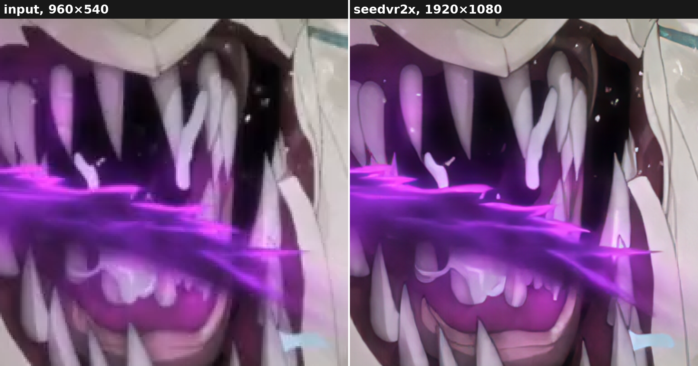

# seedvr2x

**Upscale whole films and episodes with [SeedVR2](https://github.com/ByteDance-Seed/SeedVR).**
seedvr2x takes a video file and gives back its upscale, shot by shot: a lossless master, or a
finished file with the source's audio and subtitles. A job of days stops and resumes where it
left off.



<sub>A frame of [Sol Levante](https://opencontent.netflix.com/) (Netflix and Production I.G,
[CC BY 4.0](https://creativecommons.org/licenses/by/4.0/)): its master downscaled to 960×540 and
compressed (left), then upscaled to 1080p by seedvr2x at `--quality maximum` (right), the same
square of each enlarged. [The manual](apps/seedvr2x/MANUAL.md#an-example-sol-levante) sets it
beside the original and the other levels.</sub>

SeedVR2 is ByteDance Seed's one-step diffusion model for video restoration. seedvr2x runs its
model code, as
[numz's ComfyUI-SeedVR2_VideoUpscaler](https://github.com/numz/ComfyUI-SeedVR2_VideoUpscaler)
carries it, and builds everything around it for whole films:

- **Shot by shot.** It finds the cuts itself and upscales each shot on its own, nothing crossing
  a cut. A long shot runs in overlapping windows, blended before the frames are rebuilt, which
  removes 80% of the jump at each join without softening anything.
- **Sharper still, on demand.** The model initially rebuilds 3 frames of every 4 softer.
  `--quality maximum`, the picture above, runs each shot 4 times, shifted a frame each time, and
  takes every frame from the run that rebuilds it best, in four times the GPU time. `enhanced`
  takes 1 frame in 2 from its best run and the others from the next best, in twice the time.
- **It stops and resumes.** Every piece of work is saved as it is made. Stop it, or let
  `--until 07:30` stop it before morning: the same command resumes, and the result is the
  uninterrupted run's, bit for bit.
- **It fits your GPU without tuning.** A planner sizes the work from the memory free on the
  card, and prints each choice with its reason.
- **The source's colours, the model's detail.** The model shifts colours. seedvr2x's own
  correction takes the colour back from the source and keeps the model's detail.
- **Lossless, then your way.** A 10-bit FFV1 master tagged to look like its source, every frame
  checksummed. Compress it with your own encoder's command, during the run or after.
- **Built on measurement.** Its defaults are measured, and the measurements published in
  [research/](research/) with the scripts that made them: memory, speed, quality, colour.

## Try it

On Linux (WSL2 included), with an NVIDIA GPU (one per job), ffmpeg 7.1 or later and
[uv](https://docs.astral.sh/uv/):

```
git clone https://github.com/hekmon/seedvr2x.git
cd seedvr2x/apps/seedvr2x
uv sync
uv run seedvr2x film.mkv -o film.1080p.mkv
```

The first run downloads the model files (17 GB). Each run prints its plan, then the time left.

**→ [The seedvr2x README](apps/seedvr2x/README.md)** has the rest: what ffmpeg needs, the two
workflows, the options that matter and the model files. The [manual](apps/seedvr2x/MANUAL.md)
explains every detail, for SeedVR2 users coming from numz's CLI too.

## Model files

seedvr2x downloads its own model files from Hugging Face,
[hekmon/seedvr2x](https://huggingface.co/hekmon/seedvr2x), and checks them by size and SHA-256
before every run. They are unofficial conversions, each made from its original (ByteDance's
float32 weights, TransNetV2's TensorFlow ones) by a script of [models/](models/) that pins its
inputs and checks its output. Version 0.1.0 runs the float16 files, the sharp 7B by default.

Beside them, the same 7Bs in smaller files (int8, fp8, GGUF, NVFP4), each made to lose as little
as possible:

- **Only the 288 block matrices are quantized,** 99% of the weights. The other 840 tensors
  (biases, norms, modulation tables and the 6 matrices outside the blocks) stay in 16 bits.
- **A method per format, measured weight by weight:** fp8 with a scale per tensor, int8 rotated
  before it is rounded, NVFP4's scales searched block by block for the least error, and the
  4 GB GGUF a precision per matrix, weighted by the model's own activations on anime, cel, live
  action and dark scenes.
- **Measured, not assumed:** where another repository publishes a file of the same kind,
  seedvr2x's is as close to the originals or closer, and the int8 file is as close to the
  float16 model's output as a second run with another seed, at 1080p and 4K. The
  [model card](https://huggingface.co/hekmon/seedvr2x) measures every file.

## Roadmap

- **In development: version 0.1.0,** the base version: the `seedvr2x` command for long videos,
  on Linux, one GPU per job.
- **Next:**
  - **Still images:** the same command on a picture (`seedvr2x photo.png -o photo.4k.png`),
    through the same models, tiling and colour correction.
  - **An image server:** images over HTTP, the models loaded once and kept on the GPU; the
    parameters in the request's headers, the image itself as the body, both ways.
  - **The 7B in smaller files,** int8 first: seedvr2x running the int8, fp8, GGUF and NVFP4
    files already published, the same 7B in 4.8 to 8.8 GB instead of 16.5: more frames at a
    time and less of the model moved out of a 16–32 GB card.
  - **ComfyUI nodes,** built on the same library, for ComfyUI's own workflows.
- **Later:**
  - **Windows itself:** the `seedvr2x` command on Windows, in version 0.2.0. Linux and WSL2 run
    it today.
  - **HDR sources,** their HDR10 metadata carried to the output.
  - **Machines whose CPU and GPU share one memory:** Apple Silicon Macs and NVIDIA's DGX Spark.

## In this repository

| Where | What |
|---|---|
| [apps/seedvr2x/](apps/seedvr2x/) | The `seedvr2x` command, its [README](apps/seedvr2x/README.md) and [manual](apps/seedvr2x/MANUAL.md) |
| [core/](core/) | The library the apps assemble: SeedVR2's model and each step of an upscale |
| [models/](models/) | The scripts that make the model files |
| [research/](research/) | The measurements behind every decision, with the scripts that made them |
| [DESIGN.md](DESIGN.md), [AGENTS.md](AGENTS.md) | The specification, and how to work on the code |
| [upstream/](upstream/) | numz's and ByteDance's code at pinned commits, as submodules, for the vendored code's checks and the research: `git clone --recurse-submodules` |

## Credits

seedvr2x stands on others' work:

- **[SeedVR2](https://github.com/ByteDance-Seed/SeedVR)**, by ByteDance Seed: the model, its
  weights and its code (Apache-2.0), which seedvr2x runs.
- **[ComfyUI-SeedVR2_VideoUpscaler](https://github.com/numz/ComfyUI-SeedVR2_VideoUpscaler)**, by
  numz and its contributors: the model code as seedvr2x carries it (Apache-2.0), and the
  reference all of seedvr2x's measurements started from.
- **[TransNetV2](https://github.com/soCzech/TransNetV2)**, by Tomáš Souček and Jakub Lokoč: the
  shot detector's model and weights (MIT).
- **[comfy-kitchen](https://github.com/Comfy-Org/comfy-kitchen)**, by Comfy Org: the layouts and
  the rotation of the int8, fp8 and NVFP4 files (Apache-2.0).
- **[llama.cpp](https://github.com/ggml-org/llama.cpp)**, by the ggml authors: the quantizer and
  the importance-matrix method of the GGUF files (MIT).
- **[StableSR](https://github.com/IceClear/StableSR)**: the wavelet method behind seedvr2x's
  colour correction, written anew from the method.
- **[Sol Levante](https://opencontent.netflix.com/)**, by Netflix and Production I.G: the frames
  of the picture above ([CC BY 4.0](https://creativecommons.org/licenses/by/4.0/)).
- **In the research scripts:** [DISTS](https://github.com/dingkeyan93/DISTS), by Keyan Ding
  (MIT), and [PySceneDetect](https://github.com/Breakthrough/PySceneDetect), by Brandon
  Castellano (BSD 3-Clause).
- **And what it runs on:** [PyTorch](https://pytorch.org), [FFmpeg](https://ffmpeg.org) with
  [zimg](https://github.com/sekrit-twc/zimg),
  [huggingface_hub](https://github.com/huggingface/huggingface_hub) and
  [uv](https://docs.astral.sh/uv/).

## Licence

Apache License 2.0 ([LICENSE](LICENSE)). [NOTICE](NOTICE), [core/NOTICE](core/NOTICE) and
[apps/seedvr2x/NOTICE](apps/seedvr2x/NOTICE) say what each included work is and its licence. The
submodules in [upstream/](upstream/) keep their own licences, and the model files their own card
and notices.
