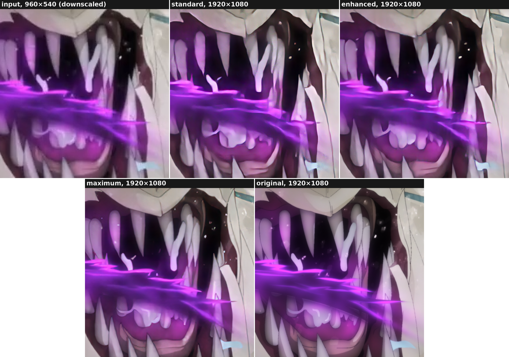

# seedvr2x: the manual

The [README](README.md) says what seedvr2x is, what it needs and how to install it. This manual
explains what would otherwise surprise you, with the reason and the measurement behind each
point. [DESIGN.md](DESIGN.md) holds every decision in full, and
[../research/docs/](../research/docs/) the measurements, linked where a figure comes from.

> **Version 0.1.0.** This manual describes seedvr2x as it is built. The few points decided
> but not built yet are marked *not built yet*, each where it is said.

What surprises a newcomer most:

- **It takes one video file, and nothing else:** no directory of segments or of frames. Every
  cut is seedvr2x's own, or yours through a cut list
  ([the two workflows](#the-two-workflows)).
- **It has no batch size,** and none of the options that go with one in other SeedVR2 tools
  ([the pipeline](#the-pipeline-for-seedvr2-users-coming-from-numz)).
- **It reads the whole source before it upscales anything.** That first pass counts the
  frames, checks the frame rate against them and finds the cuts, in minutes, up to an hour for
  a long 4K film ([how shots are found](#how-shots-are-found)).
- **It says what it does.** Before its first unit of work, every run prints its plan, a line
  per choice: the value, why it was taken, what it costs and the option that changes it. Then
  each unit's line says the time left and when the job should end. [Reading a
  run](#reading-a-run) goes through a real one, line by line.
- **It is slow, and made to be stopped.** On an RTX 5090, a 4.4-minute short to 1080p was
  estimated at about an hour and a half ([reading a run](#reading-a-run)): at that rate a
  2-hour film takes about 40 hours. Hence [resume](#resume) and
  [`--until`](#stopping-at-a-set-time), which stops before a set time, for a job run night
  after night.
- **It can run each shot several times,** for crisper frames, at 2 or 4 times the GPU time
  (`--quality`, [several runs of a shot](#several-runs-of-a-shot---quality)).
- **Its output is big:** about 100–135 GiB per hour of 1080p, lossless
  ([disk use](#disk-use)). Compressing it is your choice and your encoder's
  ([lossless delivery](#lossless-delivery)).
- **Its output is redrawn,** not a larger copy of the source: pixel metrics score it below a
  plain upscale, while eyes prefer its redraw of lines and text
  ([what the model does to a picture](#what-the-model-does-to-a-picture)).
- **It refuses rather than degrades.** A source it can't read right, a size that doesn't fit
  the card, a tool that would be inexact: each is refused with the reason and the way out
  ([refused sources](#refused-sources)), and a refusal after the first pass keeps that pass for
  the next try.
- **nvidia-smi can show the card nearly full** while the job needs much less
  ([GPU memory](#gpu-memory)).

## Contents

- [The terms, in plain words](#the-terms-in-plain-words)
- [Colour correction](#colour-correction)
- [The pipeline, for SeedVR2 users coming from numz](#the-pipeline-for-seedvr2-users-coming-from-numz)
- [The two workflows](#the-two-workflows)
- [How shots are found](#how-shots-are-found)
- [The model](#the-model)
- [What the model does to a picture](#what-the-model-does-to-a-picture)
- [Several runs of a shot: `--quality`](#several-runs-of-a-shot---quality)
- [Lossless delivery](#lossless-delivery)
- [The finished file](#the-finished-file)
- [Disk use](#disk-use)
- [GPU memory](#gpu-memory)
- [Small cards](#small-cards)
- [Under WSL2](#under-wsl2)
- [Why zscale is required](#why-zscale-is-required)
- [Refused sources](#refused-sources)
- [Colour and shape of the output](#colour-and-shape-of-the-output)
- [Resume](#resume)
- [Stopping at a set time](#stopping-at-a-set-time)
- [Integrity](#integrity)
- [Seeds and reproducibility](#seeds-and-reproducibility)
- [Reading a run](#reading-a-run)
- [Options](#options)
- [Exit codes](#exit-codes)
- [The files of a job](#the-files-of-a-job)
- [Environment variables](#environment-variables)

## The terms, in plain words

- **Frame:** one picture of the video.
- **Shot:** the frames from one cut to the next. seedvr2x upscales each shot on its own:
  nothing crosses a cut.
- **The model's two parts.** The **VAE** turns frames into a compressed form the model works
  on (the encode), and that form back into frames (the decode). The **DiT** is the part that
  restores the picture, in between. At 1080p the VAE takes about four fifths of a job's time.
- **Latent:** the VAE's compressed form of frames. A shot's first latent holds 1 frame and
  every next one holds 4, so 4n + 1 frames make n + 1 latents. Windows are counted in latents:
  13 latents are 49 frames.
- **Window:** a stretch of a shot that the model upscales in one go. A long shot is done in
  several windows that overlap a little, blended where they overlap before the frames are
  rebuilt, so the joins don't show. seedvr2x sizes the windows from your GPU's memory; you can
  cap them.
- **Tile:** a square piece of the picture. When a whole frame doesn't fit the GPU's memory, the
  VAE works tile by tile; the tiles overlap and are blended.
- **Swapped block:** the DiT is a stack of 36 blocks. A swapped block waits in system memory
  and goes to the GPU for its turn only, which leaves the GPU's memory to the window. This is
  BlockSwap.
- **First pass:** the decode of the whole source that comes before the upscale. It counts the
  frames, checks their timestamps, looks for combed frames and runs the shot detector.
- **Master:** a lossless video file: every frame as the upscale made it, to be kept, or
  compressed by an encoder.
- **Output segment:** an output file. It holds one or more whole shots, and lasts 5 seconds at
  least by default. A job's output is its segments, in a directory, or joined into one file.
- **Unit:** a piece of saved work: a shot's encode, a window, a segment's decode, and for a
  finished file its assembly. A stop loses only the unit in progress.
- **Plan:** what seedvr2x decides for a job on your card before it starts: the longest window,
  how many blocks are swapped, the tiles. Every run prints it, a line per choice.
- **Run of a shot:** one pass of the model over a shot. By default each shot has one;
  `--quality enhanced` and `maximum` give it 2 or 4, each with the shot's grid of latents
  shifted by a frame, and keep each frame from the run that rebuilds it best.
- **Scores:** how close an output is to the original. PSNR-Y and VMAF compare pixels, higher
  is closer; LPIPS and DISTS are perceptual distances, lower is closer; ΔE00 is a distance
  between colours, lower is closer. Two seeds of the model give outputs 37–44 dB of PSNR apart:
  the yardstick ([seeds](#seeds-and-reproducibility)).
- **The 96 GB card:** the card seedvr2x was developed on, whose clock a fault caps under load:
  a healthy card should take 2 to 3 times less, which isn't measured. The RTX 5090's times are
  a healthy card's.
- **Calibration:** a minute or so of the job's own work, timed once the models are loaded, from
  which seedvr2x estimates the time of every unit and of the whole job.

## Colour correction

Colour correction comes first, and in full: the model changes the colours, and every tool
around it corrects them its own way.

### The model itself shifts colours

Raw SeedVR2 output is more saturated than its input, and its hue moves with the content.

- On a dark anime clip, with colour correction off, the colours spread 34% wider on the
  green-red axis (a\*) and 28% on the blue-yellow one (b\*), towards blue, and the coarse
  colour is ΔE 4.44 from the input's
  ([quality.md](../research/docs/quality.md#colour-correction)). ΔE is a distance between two
  colours: lower is closer.
- Over 10 clips that have an original to compare with, the output is more saturated on 9, and
  shifts towards yellow on 7. "Towards blue" held on the dark anime clips alone
  ([colour.md](../research/docs/colour.md)).
- Tiles add their own: a tiled VAE shifts each tile's level and colour uniformly, by up to 2
  8-bit levels in the decode and 4 in the encode with 512-pixel tiles
  ([vram.md](../research/docs/vram.md#tiling)).

### How the others correct it

- **ByteDance's own pipeline corrects it, with a fix it can't ship.** Its inference script runs
  StableSR's wavelet colour fix after the model, but that file is under a non-commercial
  licence, so ByteDance's readme asks users to download it themselves. Without it, the script
  prints "Color fix is not avaliable" and writes the drifted output.
- **numz bundles that code,** uncredited, as `wavelet`, and adds `lab` on top, its default: the
  wavelet step, then colour matching in CIELAB. The wavelet fix does most of the work (ΔE 1.04
  from the input on that dark anime clip); `lab` brings the saturation closer still (ΔE 1.01).
- **What `lab` leaves.** Against the original, on four animated clips, it brings the coarse
  colour error down by 37–55%, to a ΔE00 of 1.07–1.58, where the input itself, plainly
  upscaled, is at 0.6–0.7 ([numerics.md](../research/docs/numerics.md)). Its wavelet step
  replaces only what is coarser than about 30–60 pixels, while the model's extra saturation
  and drift sit finer ([quality.md](../research/docs/quality.md#colour-correction)). Its
  matching step then corrects how the colours are distributed over a batch, not where they
  are, and that is what moves `lab`'s colours.

### What seedvr2x does: `split`

`split` is seedvr2x's own correction, and its default. Frame by frame, it takes from the
source what the source holds, and keeps from the model what the model adds:

- **the source's coarse colour,** below about 1.6 source pixels. That is the source's own
  colour resolution: a 4:2:0 video has one colour sample every 2 pixels.
- **the source's coarse brightness,** below about 6.5 pixels of the output;
- **the model's detail,** everything finer;
- **no matching of colour statistics,** the step that moves `lab`'s colours.

Why these scales ([colour.md](../research/docs/colour.md)):

- Colour taken finer than the source's own colour resolution costs perceptual quality (LPIPS
  and DISTS); taken coarser, it leaves colour fringes at edges. The scale follows the upscale
  factor, to stay near 1.6 source pixels: checked at ×1.5, ×2, ×3 and ×4. Between those
  factors the rule interpolates; below ×1.5 and above ×4 it is untested.
- Brightness at 6.5 pixels works at every factor measured. Coarser, at numz's 13 pixels, the
  model's own brightness flickers more than `lab`'s; finer, at 3.2, fine texture starts to go.
- Each frame needs only itself and its source frame: nothing is pooled over a shot, so the
  frames stream out as they are decoded, with no second pass.

Against numz's `lab`, as seedvr2x first built it, measured with the regular 7B on shots of 45
frames. Each line counts the clips where `split` is better / worse / within the spread
between seeds:

| Material | Colour error (ΔE00) | Other scores |
|---|---|---|
| 1080p, ×2 from a mildly degraded source (8 clips, 3 seeds) | −0.30 at full detail, −0.46 after a 4-pixel blur, −0.29 after 16 (8 / 0 / 0 each) | PSNR-Y +0.63 dB (4 / 0 / 4); LPIPS −0.0096 (7 / 0 / 1); DISTS −0.0023 (2 / 2 / 4); flicker −0.44 (6 / 0 / 2), its coarse part −0.76 (8 / 0 / 0); colour fringes −0.46 (7 / 0 / 1); no clip loses detail |
| The same, from a heavily degraded source (7 clips) | −0.27 after a 4-pixel blur (7 / 0 / 0) | PSNR-Y +0.65 dB (5 / 0 / 2); LPIPS −0.0044 (4 / 1 / 2); coarse flicker −0.70 (7 / 0 / 0); DISTS +0.0011 (1 / 4 / 2): 0.003 to 0.005 worse on four compressed inputs |
| Through the default master, 10-bit 4:2:0 | | VMAF +3.7 (7 / 0 / 1), no banding added |
| ×4 (5 clips) | −0.18 after a 4-pixel blur (5 / 0 / 0) | PSNR-Y +0.55 dB (3 / 0 / 2); LPIPS −0.0020 (4 / 0 / 1); DISTS +0.0009 (2 / 2 / 1); coarse flicker −0.58 (5 / 0 / 0) |
| 4K, ×2 from 1080p (13 shots: clean live action, animation made in 4K, a grainy scan) | −0.33 on the coarse colour (13 / 0 / 0) | PSNR-Y +0.57 dB, VMAF +5.3, coarse flicker −0.58 (13 / 0 / 0 each); LPIPS −0.0086 (10 / 3 / 0); DISTS −0.0012 (6 / 6 / 1) |

- **To the eye,** on crops beside the original: never worse than `lab`, and better where
  `lab`'s colour noise shows, a cartoon in fast motion and a compressed live-action shot.
- **Window joins:** the coarse step at a long shot's joins is 40% lower (0.046 to 0.028 of an
  8-bit level, on one clip).
- **Tiles:** after `split`, the worst 60-pixel block of a frame moves by 0.04–0.50 8-bit levels
  at 1080p and 0.14–0.49 at 4K, with decode tiles down to 512 pixels, and by up to 0.77 with
  512-pixel encode tiles: about half of what `lab` leaves. So colour sets no lower limit on
  the tiles, down to 512 pixels. It holds on flat content at 4K too, a smooth sky or painted
  animation, where the worst block moves by up to 0.77, in painted texture
  ([colour.md](../research/docs/colour.md#4k-tiles-on-flat-content)).
- **Cost:** 22.8 ms and 0.56 GiB of GPU memory per 4K frame, against `lab`'s 104.6 ms and
  0.84 GiB.
- **Licences:** the wavelet split is StableSR's method, whose code is under a non-commercial
  licence. seedvr2x's is written from the method, without that code, and holds no numz code
  either.

What `split` doesn't do: it converts no gamut and grades nothing. The primaries and transfer
of the source are the output's ([colour and shape](#colour-and-shape-of-the-output)).

### `--color-correction none`

`none` gives the raw model's colours, which drift: for comparison, or if you grade the result
yourself. The choice is one of the job's settings: a job that has made a unit with one isn't
resumed with the other ([resume](#resume)).

### The input copies

To correct a frame, seedvr2x needs the source frame the model was given. It keeps a lossless
copy of each shot's source frames (`input.mkv`, 16-bit RGB in FFV1), at the source's
resolution, written while the shot is encoded and removed when the shot's output segment is
finished: about 32 MiB per second of 1080p source (1.38 MB per frame on one clip). See
[disk use](#disk-use).

- Each copied frame has a checksum, checked when it is read back, and ffmpeg's own messages
  are read too. Both are needed: ffmpeg decodes through a damaged part of a frame with nothing
  but a line among its messages, and some damage it doesn't report at all
  ([integrity](#integrity)).
- A copy found missing before the shot's windows is made again from the source, said in a
  line, and the run goes on. A copy found missing or damaged as the shot is decoded stops the
  run, naming it ("removed, made again from the input on resuming"); the same command makes it
  again and keeps the shot's encode and windows. A lost temporary file never ends a job of many
  hours.
- With `none`, nothing is copied.

## The pipeline, for SeedVR2 users coming from numz

If you come from numz's ComfyUI-SeedVR2_VideoUpscaler, you will look for `--batch_size`,
`--temporal_overlap` or `--chunk_size`, and not find them. They aren't missing: the work they
tune is done another way. This section follows numz's pipeline with each option where it acts,
then seedvr2x's, then says why the options have nothing left to do. The
[table](#numzs-options-one-by-one) at the end is the reference.

### numz: phases over fixed batches

- It reads the whole clip into RAM, or each `--chunk_size` chunk of it.
- It cuts the clip into batches of `--batch_size` frames that ignore the cuts, each padded to
  4n + 1 frames.
- It then runs four phases, each over every batch: encode every batch, upscale every batch,
  decode every batch, colour-correct every batch.
- The latents wait in RAM between phases (`--tensor_offload_device cpu`), and the decoded
  frames gather in RAM before they are written. Without the cache options, the DiT is loaded
  for each file or chunk ([cli-flags.md](../research/docs/cli-flags.md)).

So RAM grows with the clip, every batch boundary is a visible jump, and a stop loses
everything. Most options patch what this design creates:

- `--temporal_overlap` cross-fades the batch boundaries in pixels, after decoding. Its weights
  only blend with odd values of 3 or more
  ([bug 06](../research/bugs/06-temporal-overlap-blend-weights.md)): 1, 2 and 4 are a hard
  switch that still costs compute. Even corrected, a pixel cross-fade removes 67% of the jump,
  softens the mixed frames by about 20%, and costs 16% more.
- `--chunk_size` bounds the RAM, and leaves a hard seam at every chunk boundary.
- `--cache_dit` and `--cache_vae` keep the models between files or chunks, since each chunk is
  a full run.
- `--prepend_frames` makes the clip's first frame not a batch's first. The VAE encodes a
  batch's first frame alone, and it comes out less restored
  ([quality.md](../research/docs/quality.md#--prepend_frames)). On one GPU, numz doesn't remove
  the prepended frames ([bug 05](../research/bugs/05-prepend-frames-not-removed.md)).
- `--uniform_batch_size` pads a short last batch to full size.
- The offload devices, `--blocks_to_swap` and the tile sizes fit the GPU, by hand.

### seedvr2x: per shot, from cut to cut

There is no batch. A shot of any length is padded once to 4n + 1 frames, because the VAE's
first latent holds 1 frame and every next one holds 4, and its windows are as long as the
memory allows.

- **Encode.** Frames stream from ffmpeg's decoding of the source into the VAE at the VAE's own
  pace: 5 frames, then 4 per latent. The shot never has to sit in memory.
- **Upscale.** A shot that fits the memory is one window. A longer one runs as windows of
  balanced lengths that share 2 latents (8 frames) with each neighbour; the shared latents are
  mixed before the decode, so no boundary is left inside a shot.
- **Decode.** One streamed pass over the shot, then the colour correction, and the frames are
  written into the output segments as they come out.
- **Memory.** Only the latents are ever whole in memory, so RAM stays flat whatever the length:
  2.3–2.4 GiB over a 377-frame job of 6 shots, run at 540p.
- **Tiled, it differs.** When the VAE works in tiles, as the decode does
  below 48 GB at 1080p and on every card at 4K, each tile runs over the whole shot, so the
  shot's frames wait in a scratch until the last tile: system memory up to an allowance, then
  a file beside the saved work. It takes 12.7 MB per 1080p frame and 50.5 MB per 4K frame.
- **The models stay loaded** for the whole job.
- **Every unit is saved,** so a job stops and resumes, bit for bit.

### Why the options go

- **Nothing to cross-fade.** No batch boundary is left inside a shot. Windows share whole
  latents, so there is no odd-or-even quirk, and mixing them removes 80% of a window
  boundary's jump, with no softening, for about 9% more compute on the clip measured, and an
  estimated 12% on long shots ([stitching.md](../research/docs/stitching.md)).
- **No chunks, no caches.** Streaming keeps RAM flat, and one process runs the whole job.
- **No prepended frames.** Only a shot's first frame is encoded alone, right after its cut,
  where it is least visible; numz has one at every batch. Prepending frames to it was measured
  and not kept: it costs 2–8% more GPU time on animation, and takes 0.6–2.8 dB off that frame's
  closeness to the original on 7 shots of 11
  ([cuts.md](../research/docs/cuts.md#a-shots-first-frame-prepending-mirrored-frames)).
- **No short last batch.** Windows are balanced: 21 latents under a cap of 6 run as windows of
  6, 6, 6, 6 and 5.
- **No memory options to tune.** The planner fits the GPU from its free memory: the window,
  the swapped blocks, the tiles. They stay yours to fix ([GPU memory](#gpu-memory)).

### numz's options, one by one

| numz option | seedvr2x |
|---|---|
| `--batch_size`, `--temporal_overlap`, `--prepend_frames`, `--uniform_batch_size` | gone: shots, windows and the mixing of shared latents replace them, sized by the planner; `--window` caps the windows |
| `--chunk_size`, `--cache_dit`, `--cache_vae` | gone: one process for the whole job, streaming |
| `--blocks_to_swap`, the tile sizes, the offload devices | chosen by the planner; `--swap-blocks`, `--encode-tile` and `--decode-tile` fix them, exactly or refused; no offload device to name |
| `--compile_dit`, `--compile_vae` | not in version 1: `torch.compile` is being measured on seedvr2x itself *(not built yet)*. Compiled, the DiT would compile again at every new window length, and numz's compiled VAE takes twice its memory |
| `--attention_mode` | gone: FlashAttention 2 when installed, else PyTorch's SDPA, logged |
| `--color_correction` | `--color-correction`: `split` by default, or `none`; numz's `lab`, `wavelet`, `wavelet_adaptive`, `hsv` and `adain` are gone |
| `--input_noise_scale` | gone: numz's own addition, which only degrades |
| `--latent_noise_scale` | gone from version 1: ByteDance uses 0 |
| `--seed` | `--seed`, kept |
| `--resolution`, `--max_resolution` | `--resolution`, the output's short side; nothing stands for `--max_resolution` today |
| `--output_format`, `--video_backend`, `--10bit` | `--format`: FFV1 masters (`yuv420p10le` by default, `gbrp16le`) or 16-bit PNG |
| `--dit_model`, `--model_dir` | `--dit-model` and `--model-dir`, the sharp 7B by default; the files come from seedvr2x's own Hugging Face repository, pinned; no model file is ever deleted |
| `--cuda_device` | one device per process |

## The two workflows

Both take the source, one video file: any codec ffmpeg decodes, as it is, with no intermediate
master to make first. They differ only at the end.

- **A file in, a finished file out.** `-o film.1080p.mkv` gives one file: the upscaled video,
  joined from its segments by stream copy, with every other stream of the source (audio,
  subtitles, chapters, attachments, cover pictures), as ffmpeg's own remux of the source holds
  them. Each segment's duration comes from its frame count and every timestamp sits on the
  frame grid, so the video keeps the source's timeline, frame for frame. Joined carelessly, the
  video drifts: 46 ms behind the audio over a 163-segment episode, in sptenc's measurements.
  [The finished file](#the-finished-file) says how it is made and checked.
- **The source in, a directory of segments out.** Any `-o` that isn't a `.mkv` path is a
  directory, new or empty, or an unfinished job's, which the same command resumes: the output
  segments, their checksums and the job's record ([the files of a job](#the-files-of-a-job)).
  It is what `sptenc encode <dir> <out> -f <source>` takes, or `sptenc concat` for one master.
  The default master, 10-bit 4:2:0, is the format sptenc takes as it is, with no conversion.

A video suffix other than `.mkv` (`.mp4`, `.mov`, `.m4v`, `.avi`, `.webm`, `.ts`, `.m2ts`,
`.mts`, `.mxf`, `.nut`, `.mpg`) is refused as `-o`, and so is the source itself; `.mkv` is
refused with `--format png`, whose frames go to a directory.

**Output segments follow sptenc's rule.** The cuts give the segments, then each segment
shorter than the minimum (5 seconds by default, `--min-segment`) is merged into its shorter
neighbour. The rule counts in frames: 5 seconds are 120 frames at 24000/1001.

- The merge costs no quality. A segment can hold several shots, and the model still starts
  afresh at each cut inside it: the shots are the model's units, the segments the encoder's.
- It saves what short segments cost an encoder: a forced keyframe each, and too few frames to
  make up for it.
- `--min-segment 0` keeps a segment per shot.

**A directory of segments is no input.** Segments cut by another tool carry that tool's joins,
and those aren't all cuts: of an earlier split's 411 joins, 63 scored under the threshold
ffmpeg's scene detector takes for a cut
([scene-detection.md](../research/docs/scene-detection.md)). A directory is refused, and the
message gives three ways to join segments split losslessly back into one file, each keeping
every frame at its place on the frame grid: ffmpeg alone, its command written out with each
segment's exact duration; `sptenc concat`; or, where no stream copy holds, a lossless remake.
A plain join by ffmpeg's concat demuxer gives every frame back, but each join's timestamps up
to 1 ms off, and such a file is refused once a frame lies half a frame from its place: after
21 to 68 joins at 24000/1001, by how the segments were made; none drifted at 25 fps, nor from
MP4 segments ([a frame rate its timestamps contradict](#a-frame-rate-its-timestamps-contradict)).

## How shots are found

Finding the cuts is the biggest lever on quality outside the model itself.

### Why cuts matter

- Each latent packs 4 frames, so a cut inside a group of 4 mixes both scenes in one latent.
- The VAE carries what it has seen from frame to frame, and windows are mixed where they
  overlap: across a cut, both would blend two scenes.
- Measured ([cuts.md](../research/docs/cuts.md)): a missed cut costs the next shot's first
  frames, 5–31 dB·frames of PSNR-Y on four cuts of six. A false cut costs nothing measured:
  at most a small step in coarse brightness on a shot that was continuous.

So a missed cut costs more than a false one, and seedvr2x errs on the side of cutting.

### The detector

The detector is [TransNetV2](https://github.com/soCzech/TransNetV2), the official model. It
runs on the GPU during the first pass, on every frame, and gives each frame a probability of
being a shot's last. A cut is drawn after the peak of each run of frames that reaches the
threshold, 0.3 by default.

- **Every detection starts a shot, however short.** There is no minimum shot length: real cuts
  come 1–3 frames apart in action anime, and a short shot is better run alone than merged into
  its neighbour, from 1 frame on.
- **Chosen on labelled cuts,** 130 candidates in two rounds, drawn where detectors disagree
  and judged blind
  ([scene-detection.md](../research/docs/scene-detection.md#rounds-1-and-2-pooled)).
  Against ffmpeg's scdet as usually run (threshold 10):

  | | TransNetV2 at 0.3 | scdet at 10 |
  |---|---|---|
  | Live action: cuts found | 98% | 25% |
  | Live action: detections that are cuts | 84% | 89% |
  | Animation: cuts found | 90% | 84% |
  | Animation: detections that are cuts | 82% | 62% |

  scdet takes every new drawing after a held one for a cut, so it fires in bursts: 351 per
  hour of animation, against TransNetV2's 19.
- **Why 0.3.** Against 0.5 it misses an estimated 92 cuts per hour of animation instead of
  122, and 19 per hour of live action instead of 70, for more false cuts (82% of animation's
  detections are cuts, against 89%). Below 0.3 the trade turns: at 0.2 or 0.15 each cut found
  costs 6 to 14 false cuts on animation and 14 to 21 on live action, and most of the misses
  score under 0.1, out of any threshold's reach.
- **The first pass's cost.** It decodes every frame once, in software, and the detector scores
  each. The decode alone runs at 730–2,360 frames per second on 1080p H.264 and 171 on an HEVC
  master ([seeking.md](../research/docs/seeking.md)); the detector scores 810 frames per
  second on the 96 GB card, its clock capped, 107 s per hour of source, and is then the slower of the two: the
  pass ran at 723–808 frames per second on five films. A 4-hour 4K film's pass stays about an
  hour. Against days of upscale, that is nothing.
- **Kept with the job.** The probabilities are saved with the first pass's record, so another
  threshold gives its cuts with no second decode, and a resumed job keeps its cuts.

### When it gets it wrong

- **Fast action anime** is its blind spot: it misses about 60–70 cuts per hour there (25–180
  at the ends of the estimate), cuts it scores under 0.1.
- **Fast camera work,** found in animation made natively in 4K: in a fast camera flight every
  frame differs from the last by as much as a cut does. Two real cuts there scored 0.207 and
  0.155, while a continuous shot in the same flight peaked at 0.232: no threshold separates
  them
  ([scene-detection.md](../research/docs/scene-detection.md#native-4k-animation-cuts-inside-fast-camera-motion)).
- **Still pictures** can give false cuts. They cost no fidelity, but a step may show on a held
  drawing.

What you can do, from the lightest:

1. **`--cut-threshold P`**: lower where cuts go missing, higher where false ones show. Erring
   lower is the cheaper mistake. It is one of the job's settings.
2. **The possible cuts.** `--plan FILE` writes the cuts found to FILE and, commented, the
   possible ones: each run of frames peaking from 0.1 up to the threshold. Check them in a
   player, and uncomment the real ones. Expect about 250 possible cuts per hour of animation
   and 100 of live action, one real cut in 7 to 18 of them.
3. **A cut list of your own,** `--cuts FILE`, which replaces the detection: the planned list
   edited, or any list in the same format. `--cut-threshold` is refused with it.

### The cut list

`--plan FILE` stops before the upscale and writes the list. Sol Levante, a 4.4-minute short
made in 4K, has 61 cuts at 0.3 and 39 possible cuts (40 on its 960×540 copy); planned again
at 0.2, with no decode, 76 and 24. The list of its 960×540 copy, which this manual's examples run on, starts so:

```
# seedvr2x cut list of sollevante-540.mkv: 6314 frames at 24 fps
# Shot detector: TransNetV2, transnetv2.safetensors (SHA-256 bb8c8388), threshold 0.3
# Found: 61 cuts at 0.3 (62 shots), 40 possible cuts from 0.1 up to 0.3
#
# A line per cut: the frame it cuts at, the first frame of a shot, counted from zero;
# the shot detector's peak probability, on the frame before it; the time of that frame
# from the source's start, H:MM:SS.mmm, as a player shows it. seedvr2x reads the frame
# number alone. A possible cut is a commented line: checking it is a jump to its time in
# a player.
# Uncomment a possible cut to keep it, delete a line to drop a cut, then run with --cuts
# FILE, this file.
215 0.598 0:00:08.958
454 0.863 0:00:18.917
# 456 0.109 0:00:19.000
467 0.331 0:00:19.458
519 0.920 0:00:21.625
```

- A line per cut: the frame the new shot starts at, counted from 0; the detector's peak
  probability, which it gives the frame before; and the cut frame's time from the file's
  start, rounded up to the millisecond (here at 24000/1001 frames per second).
- A possible cut is a commented line. Uncomment it to keep it; delete a line to drop a cut;
  add a line to cut somewhere else.
- seedvr2x reads the frame number alone: the first frame of each shot except the first, one
  per line, `#` for comments, anything after the number ignored. A list from another tool
  needs nothing more. Times aren't read: only a frame number is exact.
- The probability is cut to 3 decimals, never rounded up: a cut that shows 0.300 reached the
  threshold.
- A list is refused, naming the line, for a first field that isn't a whole number, a cut at
  frame 0, cuts that don't increase, or a cut past the source's last frame. An empty list is
  one shot.
- Where the source has frames missing, frame numbers count their filled places too
  ([missing frames](#missing-frames)), and the list's header says so.

Then run with `--cuts FILE`. `--plan` also leaves the job's record and frame index in the
output directory, or in `film.1080p.mkv.work` for a finished file: the same command without
`--plan` runs the plan with no second first pass, and another `--cut-threshold`, a `--cuts`
list or any other setting the first pass doesn't read plans it again from that record, with no
decode.

### Checking a cut in a player

The time on each line is there for this. Measured on VLC 3.0.24:

- VLC's Go to Time (Ctrl+T) takes whole seconds. Type the hours, minutes and seconds of the
  cut's time, then step a frame per press with E: the cut comes within the second.
- VLC doesn't step back (Shift+Left goes 3 seconds back).
- On a `.ts` file its seeks are rough: go a few seconds earlier, and play.
- **The playlists.** With the shots detected, `--plan FILE` also writes two playlists beside
  the list, named after it: with `--plan film.cuts.txt`, `film.cuts.txt.cuts.m3u8` for the cuts
  and `film.cuts.txt.possible.m3u8` for the possible ones. VLC
  plays an entry per cut, from a second before it to 3 seconds after, then goes on to the
  next by itself: no time to type. Each entry's title gives the cut's frame, time and
  probability:

  ```
  #EXTINF:-1,possible cut 456 at 0:00:19.000 (0.109)
  #EXTVLCOPT:start-time=18.000
  #EXTVLCOPT:stop-time=22.000
  sollevante-540.mkv
  ```

  A playlist names the source by its file name alone, so it plays from the source's directory:
  keep it there, or move it beside the source. On Matroska the cut fell inside its entry for 19
  cuts of 19; on MPEG-TS, for 14.

mpv lands on the cut frame from the list's time itself.

## The model

Version 1 runs ByteDance's SeedVR2 7B in float16, with its VAE in float16. ByteDance
publishes two 7B models of the same architecture, memory and time:

- **The sharp 7B is the default.** Judged by eye on 75 crops at 4K and 1080p, it was preferred
  or no different on 67 (preferred on 27, the regular 7B on 8). At 4K it invents less of the
  fine texture the eyes rejected with the regular 7B, whose skin came out "almost reptilian"
  on a grainy film. No measured guard gets worse: the same banding and colour, fewer colour
  fringes, less flicker. At ×2 to 1080p the metrics barely tell the two apart
  ([colour.md](../research/docs/colour.md#step-6-the-sharp-7b-for-the-eyes)). Despite its
  name, it adds no more fine texture than the regular one there, on average.
- **The regular 7B is the reference** every check of seedvr2x is made against, numz's own
  runs among them. `--dit-model seedvr2x_ema_7b_fp16.safetensors` runs it.
- **At other upscale factors** than ×2, the sharp 7B's lead isn't settled. The metrics side
  with it at ×1.5 (3 clips of 3) and mostly at ×3, and are mixed at ×4, where one clip is
  3.5 dB further from the original; no eyes have looked yet.

The files, where they come from and how they are checked are in the README's
[Model files](README.md#model-files); the [model card](https://huggingface.co/hekmon/seedvr2x)
has the table of every format. A later phase brings
the smaller files of both 7Bs, each with its measured quality. The VAE stays in float16: its
weights take 0.47 GiB, so a smaller file would save nothing, and its memory is the pictures it
computes, which tiling bounds.

## What the model does to a picture

SeedVR2 restores: it redraws the picture rather than enlarging it. That is what it is for,
and it changes what a measurement means. A metric that compares the output with an original
rewards a copy of that original's own blur and grain. seedvr2x uses such metrics as guards
against damage (colour drift, flicker, banding, artefacts), and eyes for the look.

### On live action

Measured ([numerics.md](../research/docs/numerics.md)):

- The perceptual metrics side with the model over a plain upscale, and the pixel ones with
  the plain upscale.
- It redraws grain and detail of the right kind at the wrong place.
- Its grain follows its input's. From an input that kept a quarter of a film's grain, it gave
  back about half; from one that kept most of it, a little more than the original's.

### At 4K

×2 from 1080p, it redraws rather than enlarges
([colour.md](../research/docs/colour.md#step-5-4k-on-clean-and-grainy-sources-and-a-detail-strength)):

- Metrics against an original put it behind a plain upscale, on clean sources as on grainy
  ones: on PSNR-Y and VMAF on every one of 17 shots (PSNR-Y 4–9 dB lower), on LPIPS and DISTS
  on most. It adds less banding than the plain upscale on 16 shots of 17, and the eyes prefer
  its redraw of lines and text.
- The regular 7B invents fine texture the eyes rejected. The sharp 7B, the default, invents
  less of it and keeps the redraw: 2.6–5.7 times the original's fine detail per kind of source
  on 13 shots, against the regular 7B's 3.4–7.3.
- A more compressed input changes neither.
- Clouds and smooth gradients from compressed sources can still show light artefacts.

There is no strength or detail option in version 1. What remains of the over-rendering goes
both ways with the content, and the one global blend measured washes lines out to the eye.

## Several runs of a shot: `--quality`

`--quality` is the one option that buys quality with time. `standard`, the default, runs the
model once over each shot; `enhanced` runs it twice and `maximum` four times, each run with
the shot's grid of latents shifted by a frame, and keeps each frame from the run that rebuilds
it best. It costs 2
or 4 times the GPU time, and no more memory.

### Why one run isn't the best the model can do

The VAE packs a shot's frames 4 to a latent (after the first, which has one of its own), and
the 4 frames of a latent don't come back equal. The last of the 4 is rebuilt best; the three
before it come out softer, and on fast motion they carry ghosts: line art drawn twice. On 8
clips that have an original to compare with, a group's last frame was 0.8–5.0 dB of PSNR-Y
closer to it than the group's second
([numerics.md](../research/docs/numerics.md#every-fourth-frame-the-latent-grid)).

So `maximum` runs the shot 4 times, from its frame 0, 1, 2 and 3: every frame then ends a group
of 4 in one of the runs, or is a run's own first frame, packed alone, and is taken from that
run. `enhanced` runs it from frames 0 and 2, and
takes each frame from the run where it sits third or fourth in its group. Each run is a whole
run of its own, windows, colour correction and all.

### What it gives

Measured on 8 clips at 1080p, against one run: `maximum` +2.01 dB of PSNR-Y and +10.4 of VMAF
before colour correction (+1.51 and +7.85 after `split`), on every clip beyond the spread of
seeds, from +0.06 dB on a slow pan over a near-flat sky to +3.96 dB on a dark anime clip, and
less flicker on every clip: the runs differ as seeds do, but don't flicker once mixed. To the
eyes, blind, the several runs' frames won on 8 stills of 8 ("the sharpest, the cleanest; the
other is way more blurry") and on 4 loops of 4, 2 of them hard to tell in motion. `enhanced`
gives 37–47% of `maximum`'s gain for half its time, and beat one run on 7 stills of 8
([numerics.md](../research/docs/numerics.md#every-fourth-frame-the-latent-grid)).

Where it gains most and least:

- **Fast motion and line art gain the most,** at 1080p and at 4K. At 4K, on a fast tilt in a
  grainy cel animation, the eyes took `maximum` on every place shown ("way better: the other
  looks like a draft").
- **A slow pan over flat colour hardly gains,** and still shots change little.
- **At 4K, live action is mixed.** `maximum` came closer to the original on every shot measured
  ([numerics.md](../research/docs/numerics.md#more-shots-and-a-second-seed)). The eyes took it
  on clean digital footage, a face in a helmet ("cleaner", "finer and more controlled
  details"); on the one grainy live-action film tried, they preferred `standard` more often:
  smoother skin, less noise. One film: try yours (below).

### An example: Sol Levante

The picture below is from [Sol Levante](https://opencontent.netflix.com/), an animated short
Netflix released under a free licence. A bird crosses a painted wave, fast, its beak open: each
panel is the same square of the same frame, to be read in order.

1. **The input,** what seedvr2x was given: the short's UHD master scaled down twice, to
   960×540, and compressed with x264, as a web video would be. It is enlarged without
   smoothing, so that its own pixels show.
2. **`standard`, `enhanced` and `maximum`:** seedvr2x's 1080p output at each level. The teeth's
   lines wobble at `standard`, a little less at `enhanced`, and keep the original's shape at
   `maximum`.
3. **The original:** the master scaled down once, to 1080p, before the input was made from it:
   what the input lost. No tool is given it; it is there to set each level against.



*[Sol Levante](https://opencontent.netflix.com/), Netflix and Production I.G, CC BY 4.0
(https://creativecommons.org/licenses/by/4.0/). Frames of the SDR UHD master, downscaled,
compressed and upscaled here to compare seedvr2x's --quality levels. Each panel is the same
square of the frame: 384 pixels of the 1080p ones, enlarged 3 times, and 192 of the input's,
enlarged 6 times. Click the picture for its full size.*

Against the original, over the 73 frames of each extract, `maximum` against `standard`:

| Extract | PSNR-Y | VMAF | LPIPS | Flicker (temporal error) |
|---|---|---|---|---|
| The bird across the wave (above) | +1.92 dB | +11.8 | −0.021 | 4.44 → 3.39 |
| A close-up pulling back fast | +1.50 dB | +10.1 | −0.017 | 6.88 → 5.76 |
| Trees against a sunset sky, almost still | +0.16 dB | +1.0 | −0.002 | 2.72 → 2.71 |

Higher PSNR-Y and VMAF, and lower LPIPS and flicker, are closer to the original.

### What it costs

- **GPU time:** 2 or 4 times `standard`'s. `--plan` prints the job's time at each level on your
  card before anything runs (`time at each --quality: standard about …, enhanced about …,
  maximum about …`), and at 4K a 45-frame shot took about 63 minutes at `maximum` against 15 at
  `standard`, on a 96 GB card whose clock is capped.
- **Memory:** none more. A run takes the memory one run takes, and the plan is the same.
- **Disk:** the earlier runs' frames wait on disk until the last run's decode puts every frame
  in order, at 16 bits so that no byte of the master changes: up to half of the longest shot at
  `enhanced` and three quarters at `maximum`, 12.4 MB a 1080p frame and 49.8 MB a 4K frame, so
  37 GB for a 1,000-frame shot at 4K. The plan's `quality:` line gives it, and a job whose disk
  can't hold it is refused before the models load, its first pass kept.
- **It is a setting of the job:** a job that has made a unit is never resumed at another level.
  A plan, which has made none, takes another level without a second first pass.

The bird's 73 frames at `maximum` on an RTX 5090: the plan's line, then each run's units, named
by the frame it starts from.

```
05:52:56 plan: quality: maximum, 4 runs a shot, 8 in all, each frame from its best run: about 4 times standard's GPU time, one run's memory; 0.56 GiB of frames on disk for the longest shot; --quality standard or enhanced: 1 or 2 runs
05:55:15 time: about 4 min 20 s on this GPU as it runs now: 1 min 4 s for 8 encodes, 53 s for 8 windows, 2 min 23 s for the decode and write of 1 segment
05:55:58 shot 1/2, run 2/4 (from its frame 1), frames 1 to 62 (62), seed 42: encoded in 13.1 s, VRAM peak 19.88 GiB; about 3 min 48 s left, the job ending about 06:00
05:56:13 shot 1/2, run 2/4 (from its frame 1): window 1/1, latents 0 to 16, in 11.6 s, VRAM peak 21.80 GiB; about 3 min 38 s left, the job ending about 06:00
```

### Trying it on your own video

Before paying for a whole film, run an extract both ways and look at them, paused on motion and
in motion. A few seconds with fast motion or line art in them tell the most:

```
ffmpeg -ss 0:12:30 -i film.mkv -t 10 -map 0:v:0 -c copy extract.mkv
uv run seedvr2x extract.mkv -o extract.standard.mkv
uv run seedvr2x extract.mkv -o extract.maximum.mkv --quality maximum
```

A stream copy cuts at a keyframe, so the extract may start a little before 0:12:30. Then
`--plan` on the whole film prints what each level would cost there, before anything runs:

```
uv run seedvr2x film.mkv -o film.1080p.mkv --plan film.cuts.txt
```

## Lossless delivery

seedvr2x delivers the upscale, losslessly, and has no encoder options: no codec, no quality
setting, no preset. How the output gets compressed is your choice, with your encoder and its
flags: afterwards, from the master, or during the run with `--segment-cmd`.

### The formats

`--format` chooses among three, all written from the model's float frames, with no 8-bit
step:

- **`yuv420p10le`, the default:** an FFV1 master in 10-bit YUV 4:2:0, limited range, BT.709 at
  HD sizes. It is what encoders take. The conversion from the model's RGB happens once, here,
  exactly (white at 940). Left to whatever reads an RGB master, it can come out a little off:
  ffmpeg's default converter puts white at 943.
- **`gbrp16le`:** an FFV1 master in 16-bit RGB, the closest to the model. It is five times as
  big (measured with `lab`, the earlier correction), and meant for precision work and
  measurements on short samples, not for whole films.
- **`png`:** 16-bit PNG files, a directory per segment, frames numbered from `000000.png`.

The FFV1 masters have every frame a keyframe, a checksum per slice, and the source's exact
frame rate. The 4:2:0 master's colour is reduced with a bilinear filter, measured against
four sharper ones: the lowest colour error on every one of 8 clips
([numerics.md](../research/docs/numerics.md#the-masters-chroma-420-kernels-and-zscales-slices)).

### `--segment-cmd`: your encoder, during the run

A lossless film is too big for most disks, and one pipe into one encoder can't be paused. So
seedvr2x runs your command once per output segment:

```
uv run seedvr2x film.mkv -o film.1080p.mkv --segment-cmd 'ffmpeg -i - -c:v libx265 -crf 16 {out}'
```

- **Its input:** the segment on its standard input, lossless and tagged: the master's own
  stream, FFV1 in Matroska, in the master's format (`yuv420p10le` by default, so your encoder
  converts nothing), with its colour tags and its exact frame rate.
- **Its output:** the file seedvr2x names, which `{out}` stands for. Write `{out}` bare, never
  in quotes: seedvr2x puts the name in, quoted for the shell. A command without `{out}` is
  refused.
- **It is run by `/bin/sh`,** never parsed. Anything a shell runs will do, and a command that may
  need mending is best kept in a script that the option names.
- **Tried before any work,** at every start, a resume's included: the command is run on 5 black
  frames of the output's size, format and tags, in a scratch directory whose name holds a
  space, a quote and a dollar on purpose, so that a quoted `{out}` fails there and not hours
  later. Its line, with libx265 on a 1080p film: `--segment-cmd: tried on 5 black frames, 1920x1080
  yuv420p10le at 24000/1001 fps, in 0.3 s`.
- **Checked:** its exit status, then the frames of its file, decoded and counted against those
  written. A failure stops the run at that segment, saying the command's status and its last
  lines; the finished segments and the next shots' work are kept, and the same seedvr2x command
  resumes there, no model work done again.
- **For a finished file,** its files must be joinable: Matroska (with ffmpeg, an `{out}` ending in
  `.mkv`, which the name seedvr2x gives does), every frame at its time on the rate, and the same
  codec, size, format and settings from one segment to the next. The trial's file is asked too,
  so a command whose files can't be joined is refused before any work. A directory output asks
  nothing of them.
- **It is a setting of the job:** another command is another job. Refused with `--format png`.
- Disk use is then the compressed size, and a stop keeps every finished segment.
- The frames in those files are your encoder's: they get no checksum from seedvr2x, and
  `seedvr2x verify` counts them ([integrity](#integrity)).

This is why output segments last 5 seconds at least: an encoder pays for each short segment
with a keyframe it can't make up for.

## The finished file

`-o film.1080p.mkv` names the finished file. Until it is whole, the job lives in a work
directory beside it, `film.1080p.mkv.work`, a job directory in every respect
([the files of a job](#the-files-of-a-job)): made and locked at the start, so that a second
run to the same file is refused, and resumed by the same command.

**Refused before any work.** The finished file takes every other stream of the source, and
drops or converts none in silence. So at every start, before the first pass, seedvr2x tries
each of the source's other streams into Matroska with ffmpeg itself, then rehearses their whole
remux (2 to 3 minutes on a film of 33 GiB, under 2 s on files up to 5 GiB). It refuses, naming
the stream and giving the remux that mends the source:

- a stream Matroska can't hold: MP4's `mov_text` subtitles (the remux converts them to SubRip,
  their text and times kept, their styling lost), Blu-ray PCM (rewrapped as it is, nothing
  lost), DVD PCM, CEA-608 captions, a MOV's timecode track, an MP4's chapter track, an MPEG-TS
  data stream (left out by the remux);
- anything ffmpeg warns of in that remux;
- a stream that starts before the file's start, by which Matroska's muxer would move every other
  stream, the video off its grid with them;
- a first video frame before the file's start, found by the first pass.

A directory output takes every such source: its segments are then muxed with the source's
streams by your own tools.

*Not built yet:* a data stream Matroska can't hold (a timecode track, an MP4's chapter track) left
out with a warning naming it, instead of refused.

**The assembly** is the job's last unit, made once the last segment is finished, or by a later
run of the same command, which loads no model. One ffmpeg process joins the segments by stream
copy, every frame on the grid: frame k at the source's first frame's time plus k frames,
rounded once to Matroska's millisecond. The video's timestamps are then the source's, less the
source's start time, as ffmpeg's own remux writes them. The other streams come as that remux
holds them: packets, chapters, languages, titles, dispositions, attachments, the video in the
source video's place.

**Proven before it is put in place,** without a decode: each video packet is the one the join
read, at its place on the grid, with the first segment's codec headers; every other stream's
packets equal a remux of the source's; the attachments and the chapters are the source's. A
failure removes the partial file and keeps the segments. Then, each step safe to stop after:
the file put in place, its checksums written beside it (`film.1080p.mkv.crc32`, one per frame),
the work directory removed. Its lines:

```
05:45:58 bird.1080p.mkv: assembled, 73 frames of 1 segments with 0 other streams and 0 chapters of bird-540.mkv, 0.10 GiB: joined in 0.7 s, checked by its packets in 0.5 s; the other streams at most 0.00 s ahead of the video in the file
05:45:58 wrote bird.1080p.mkv: 73 frames from 1 segment, with the source's 0 other streams and 0 chapters, assembled in 1.1 s
05:45:58 bird.1080p.mkv.work: removed, its job assembled
```

*Not built yet:* the job's manifest kept beside the finished file (`film.1080p.mkv.manifest.json`),
so that the same command again makes nothing and another job to that file is refused. Today
only the file and its checksums remain, and a new job to the same name replaces the file once
its own is whole.

**Disk:** while it is assembled, the segments and the file sit side by side, about twice the
master, and the other streams twice more while they are compared. Without the room the run
stops before the join, saying how much more it needs, every segment kept, and the same command
assembles later.

## Disk use

**The output.** Per hour of 1080p at 24000/1001 frames per second, and four times that at 4K:

| Format | Per hour of 1080p |
|---|---|
| `yuv420p10le`, the default | about 100–135 GiB |
| `gbrp16le`, with colour correction (measured with `lab`, the earlier one) | 540–690 GiB |
| with `--segment-cmd` | what your encoder makes of it |

The 16-bit RGB master is that big because the corrected output fills its 16 bits: tens of
thousands of distinct values in a frame.

**During a run,** beside the output:

- **The input copies** the colour correction reads: about 32 MiB per second of 1080p source,
  for the shots of the segment being made, removed when it is finished
  ([the input copies](#the-input-copies)).
- **The saved units:** each shot's latent, removed once its windows are done, and each
  window's output, removed once the shot's segment is finished.
- **A tiled shot's scratch:** 12.7 MB per 1080p frame and 50.5 MB per 4K frame, in system
  memory up to an allowance, then whole in a file (`scratch.bf16`), for the one shot being
  encoded or decoded. The plan's `scratch:` line says which.
- **With `--quality enhanced` or `maximum`,** the earlier runs' frames, for the shot being made:
  up to half of it or three quarters, 12.4 MB a 1080p frame and 49.8 MB a 4K frame
  ([what it costs](#what-it-costs)).
- **While a finished file is assembled,** the segments and the file side by side: about twice
  the master ([the finished file](#the-finished-file)).

**Checked before the run.** Once the plan is made, before the models load, the job's disk is
checked against what it writes beside its manifest at its largest shot's peak: the frames kept
between runs and a scratch file. Short of room, the job is refused, saying how much each part
takes and the ways out (make room, another disk, a lower `--quality`, free system memory for
the scratch), its first pass kept; `--plan` only warns. The masters, the segments and the
input copies aren't counted: their size follows the content.

**Once:** 17 GB of model files in Hugging Face's cache ([README](README.md#model-files)).

## GPU memory

### What nvidia-smi shows

nvidia-smi can show the card nearly full while the job needs much less. PyTorch's allocator
keeps the memory it has freed reserved for itself, and trims it only when an allocation would
fail. The figures to read are the peaks seedvr2x logs for each unit, and those the plan
predicts. On Linux the allocator is `cudaMallocAsync`, which trims its pool on a full card where
PyTorch's native one fragments and fails; [under WSL2](#under-wsl2) it is PyTorch's own, with
expandable segments. seedvr2x sets it through `PYTORCH_CUDA_ALLOC_CONF` unless you have set
that variable or `PYTORCH_ALLOC_CONF` (an empty one counts as unset).

### Which phase sets the peak

A shot goes through three phases, and each has its own peak
([vram.md](../research/docs/vram.md)):

- **The DiT's peak follows the window's length:** 15.9 GiB of weights, the DiT's and the VAE's, plus about 1 GiB per
  latent at 1080p and four times that per latent at 4K. This is where a card's memory turns
  into quality: a longer window means fewer joins in a long shot.
- **The VAE's peak follows the frame's size, not the shot's length,** since it works through
  the frames 4 at a time and keeps nothing of the shot on the GPU: about 19 GiB to encode and
  35 GiB to decode at 1080p, and four times as much at 4K, about 134 GiB for the decode. No card
  decodes a 4K frame whole, which is why 4K needs tiles: about 18 GiB with tiles of 1024 pixels.

### The plan

seedvr2x makes one plan per job, after the first pass and before the models load, and prints
it at every run, a line per choice ([reading a run](#reading-a-run)).

- **From the memory free at the start,** less a margin of 0.6 GiB left to the desktop and other
  programs: the budget. What counts is what is free, not the card's size: a card that drives a
  desktop is judged by what it has left, and a 96 GB card half taken by another program is a
  48 GB one to seedvr2x. On Linux, the plan is made once: what another program takes later
  isn't planned for. [Under WSL2](#under-wsl2) the plan counts on less, and each unit checks.
- **The window first,** the biggest lever on quality: the longest shot whole when it fits,
  else the longest window that fits, with the VAE off the GPU and as many blocks swapped as it
  takes. A card swaps blocks before it shortens a window.
- **Then the fewest swapped blocks** that hold that window. The planner never swaps 1 or 2:
  the two blocks being streamed take the GPU memory those would free.
- **Then the largest tiles,** for the decode, then for the encode, and none where the whole
  frame fits. The DiT leaves the GPU for the VAE's phases before a tile shrinks. Tiles are
  squares of 512 to 2048 pixels, in steps of 64, overlapping by 64, cut off at the picture's
  edges. A frame takes the same time whatever the tile.
- **Every VAE pass keeps 1.25 GiB of the budget free,** the VAE's room, for the large pieces of
  memory a pass asks for at once. Packed closer, a pass can run and give other frames without a
  word: cuDNN, refused a workspace, falls back to other kernels
  ([DESIGN.md](DESIGN.md#memory-planner)).
- **Then the system memory.** A plan the host's memory can't hold is changed before it is
  refused: the VAE stays on the GPU and more blocks are swapped, then the DiT stays on the GPU
  for the VAE's passes and their tiles shrink, then the window shortens. Each such line says
  so, with the figures (`shortened from 17 latents for the host's memory`).

The windows this gives at the two usual sizes, in latents (and frames), for cards with nothing
else on them (an N GB card having about N − 1.5 GiB free), from the planner's own figures:

| Card | 1080p, no block swapped | 1080p, all 36 swapped | 4K, no block swapped | 4K, all 36 swapped |
|---|---|---|---|---|
| 16 GB | the weights don't fit | 12 (45) | the weights don't fit | 3: under 5, refused |
| 24 GB | 6 (21) | 20 (77) | under 5: swaps instead | 5 (17) |
| 32 GB | 14 (53) | 28 (109) | 3: swaps instead | 6 (21) |
| 48 GB | 30 (117) | 44 (173) | 7 (25) | 10 (37) |
| 96 GB | 77 (305) | 91 (361) | 19 (73) | 22 (85) |

A window takes 5 latents at least (it shares 2 with each neighbour and keeps one of its
own), so a cell under 5 is under the floor: the plan swaps blocks instead, and where all 36
swapped still hold fewer than 5, the job is refused. By the planner, 4K's 5-latent window takes
36.74 GiB free with every block on the GPU and 22.40 with all 36 swapped: a 24 GB card swaps all
36, a 16 GB card is refused.

A 96 GB card ran windows of 76 latents (301 frames) at 1080p with every block on the GPU, and
of 22 at 4K with all 36 swapped; a card held to 24 GB ran 4K's windows of 5.

- **Nothing caps a large card:** the memory a small card spends on swapped blocks and tiles
  goes, on a large one, to longer windows.
- **A size that doesn't fit is refused, never degraded.** No window goes under 5 latents: a
  window in the middle of a shot shares 2 with each neighbour and keeps at least one of its own.
  When the smallest window doesn't fit with every block swapped, or the smallest tiles don't,
  the job is refused before the models load. The message gives the free memory that size
  takes, what is free, and the largest output size that fits: 4K takes 22.40 GiB free
  (23.47 without FlashAttention 2), so a 16 GB card never runs it, and 1080p takes 8.27 GiB, so
  an 8 GB card doesn't run that either. A shot's length doesn't count on the card: a very long
  shot is bounded by the host's memory alone, its refusal naming the shot.

### Fixing a choice yourself

`--window N`, `--swap-blocks N`, `--encode-tile PX` and `--decode-tile PX` (0 for an untiled
pass) each fix one choice, and the planner makes the others around it. What you fix is taken
exactly or refused, never adjusted: the refusal names what fits, the longest window, the fewest
blocks or the largest tile.

- `--window N` caps the windows, 5 at least: no window is longer than N latents, and a shorter
  shot is still one window of its own length.
- `--swap-blocks N`, from 0 to 36: the DiT's last N blocks wait in system memory. 0 keeps every
  block on the GPU. 1 or 2 free nothing.
- `--encode-tile PX`, `--decode-tile PX`: a multiple of 64 from 512 up, or 0. A tile as large as
  the padded frame is refused (`--decode-tile 0` pins an untiled decode), and a tile above
  2048 px, the largest measured, is taken with a warning that its peak is a fit's.
- Of two pins that don't fit together, `--window` is refused while some cap fits the blocks
  pinned, `--swap-blocks` when none does.

A refusal reads like this (here `--window 40` at 1080p on a card with 22.51 GiB free):

```
--window 40: its longest window, 39 latents, takes 41.30 GiB of free VRAM with every block of the DiT swapped, and the driver reports 22.51 GiB free: the longest window that fits is --window 17
```

### A plan shapes the output a little

Its window lengths set where a long shot's joins fall, and its tiles where the picture is cut.
A larger card gives fewer joins and larger tiles.

- Windows change the output about as much as a change of seed does: 41.9 dB from the
  one-window run on one clip, where two seeds are 37–44 dB apart
  ([models.md](../research/docs/models.md)).
- Tiles drift in colour, each as a whole, and more as they get smaller. The colour correction
  removes most of it ([colour correction](#what-seedvr2x-does-split)). On crops of 5 clips
  with flat areas, tiled against untiled, the eyes saw no difference on 16 places of 37, took
  the untiled run on 7 and the tiled one on 6, by small margins ("hard to tell", "a little
  bit"), the rest undecided or nothing in them to judge.

So the plan is part of the job: its window cap and its tiles are recorded, as are your
`--window` and tile pins, and a resumed job keeps them ([resume](#resume)). Two runs with the
same settings and the same plan give the same output, bit for bit; swapping blocks changes no
bit, so `--swap-blocks` isn't a setting, and a resume may swap more or fewer.

## Small cards

seedvr2x is developed on a 96 GB card and made for cards of 16 to 32 GB too, checked on an RTX
5090 with a desktop running. There, the plan decides whether a job runs at all, and it asks
more of the rest of the machine.

**What a small card asks of the host:**

- **Pinned system memory for what leaves the GPU:** 0.42 GiB per swapped block, 15.19 GiB with
  all 36, 15.81 with the DiT's other parameters and the VAE when the plan keeps the two models
  apart. A swapped block is copied to the GPU from pinned memory, which the system can't page
  out: 57 GB/s, against 18–25 from ordinary memory. Nothing is copied back, since the weights
  never change.
- **A tiled shot's scratch,** up to its allowance in system memory: 12.7 MB per 1080p frame,
  50.5 MB per 4K frame. The allowance is half of what the host has left once the pinned copies
  and the shot are counted, and no more than the longest tiled shot needs; past it, a shot's scratch goes
  whole to a file on the job's disk. Where the host's memory can't be read, said in a warning,
  it is the longest shot's whole scratch, 8 GiB at most.
- **The process itself:** 2.3 to 2.5 GiB once the weights are loaded, flat whatever the job's
  length. The weights are read straight into place, never mapped: a load peaks at 1.1 GiB with
  nothing pinned, 7.5 with 6.38 GiB pinned, 16.3 with the 36 blocks'.

The plan counts all of this against the host's available memory, a container's limit
included. A job it can't fit, or whose copies the host won't pin, is refused before the run,
naming the memory it needs, part by part.

**What a small card can't run:** a size whose smallest window or smallest tiles don't fit,
counted from what is free at the start, not from the card's size. 4K takes 22.40 GiB free.

**What to expect:**

- A 16 GB card can't hold the model's 15.35 GiB of weights: it swaps every block.
- Below 48 GB, a 1080p decode only fits tiled; at 4K every card tiles it, the 96 GB one
  included.
- These cards also compute more slowly: an RTX 5080 has 84 compute units (SMs) where the
  96 GB card has 188. A job lasts longer there, and [resume](#resume) and
  [`--until`](#stopping-at-a-set-time) matter most.
- A later phase brings smaller model files, which lighten the swapping
  ([README](README.md#which-file-to-use)).

## Under WSL2

In practice: nothing to set. The plan counts on about 5 GiB less than the card has free, keep
other programs off the GPU during a job, and run one seedvr2x per card. Why:

Under WSL2, the GPU is Windows', and Windows' driver gives memory the card doesn't have: past
the card, it lends system memory, whatever NVIDIA's "CUDA - Sysmem Fallback Policy" says. A
window over the card then runs 2 to 3 times slower, until CUDA fails with an error no program
can catch, and the process aborts. So there, seedvr2x holds itself to the card, and says so at
its start:

```
WARNING the GPU's driver gives memory the card doesn't have (...): system memory in its place, as Windows' driver does, under WSL2 too whatever NVIDIA's "CUDA - Sysmem Fallback Policy" says. ...
```

- **It reads the whole card's free memory** through NVML, the driver's own figure being the
  process's, not the card's. PyTorch is limited to that, less 0.5 GiB left to the rest of the
  card, and a step past the limit is refused, an error the run catches, where the driver would
  have lent.
- **The plan counts on 4.5 GiB less again,** the reserve PyTorch's allocator needs beyond a
  step's peak there (the 0.6 GiB margin is inside it). So the plan's budget is well under what
  nvidia-smi shows free: on an RTX 5090 beside a desktop holding 4.6 to 5.8 GiB of the card,
  the plan counted on 20.0 to 21.2 GiB of the 25.0 to 26.2 free. The plan's first two lines give
  each figure.
- **Where a job would be refused with 4.5, it takes 2.5,** said in its `budget:` line: a step
  short of room then slows down rather than being refused, and a job that fits with 4.5 runs up
  to 1.5 times as long with 2.5. It takes the same frames. A resume whose recorded plan no
  longer fits with 4.5 takes 2.5 too, before it stops. This holds under PyTorch's own allocator
  with expandable segments, seedvr2x's default there; under an allocator of your own the job is
  refused with 4.5, the refusal saying so. With 2.5, an RTX 5090 ran 4K's smallest window
  beside a desktop holding 3.2 GiB. Its plan of the Sol Levante example at 4K, without
  FlashAttention 2, says it so:

  ```
  06:02:17 plan: budget: 24.19 GiB, the 27.19 GiB free less torch's limit, 0.50 GiB under it, and the reserve of 2.50 GiB left to torch's allocator beyond a step's peak, 2.50 and not 4.50, the plan with 4.50 refused (an output of 3840x2160 takes 22.87 GiB of free VRAM (its smallest window, 5 latents, with every block of the DiT swapped and the VAE off the GPU: a peak of 22.87 GiB), and the plan counts on 22.19 GiB of the 27.19 GiB free on the whole card by NVML (its driver reports 30.02 GiB free to this process), the run held to the card's own memory: 0.68 GiB more would have to be freed on the card for it; the largest output that fits there is --resolution 2112, about 3754x2112); slow: a step short of room beyond its peak slows down where it would be refused, and a job that fits with 4.50 runs up to 1.5 times as long with 2.50; memory freed on the card gives the 4.50 back; the margin of 0.60 GiB is in the reserve
  06:02:17 plan: windows: 5 latents at most (17 frames), the longest the budget holds: 8 of 62 shots in one window, 471 joins; a longer window, fewer joins; --window N caps them
  ```

  Windows of 5 latents, the least a job runs: 4K fits that card, just, and the job was
  estimated at about 7 hours. Its 22.87 GiB is the smallest window's peak under SDPA alone: on
  Linux the 0.6 GiB margin comes on top (23.47, or 22.40 with FlashAttention 2,
  [GPU memory](#the-plan)), where under WSL2 the reserve holds it.
- **What a job needs free,** by the planner's own rules, on the whole card (NVML's figure):

  | Output | On Linux | Under WSL2, to run (reserve 2.5 GiB, slower) | Under WSL2, at full speed (reserve 4.5 GiB) |
  |---|---|---|---|
  | 1080p | 8.27 GiB | 10.67 GiB | 12.67 GiB |
  | 4K, FlashAttention 2 | 22.40 GiB | 24.80 GiB | 26.80 GiB |
  | 4K, SDPA | 23.47 GiB | 25.87 GiB | 27.87 GiB |

  Under WSL2, the Linux floor's 0.6 GiB margin goes, and the 0.5 GiB left to the card and the
  reserve come on top. The RTX 5090 above had 27.19 GiB free: 0.68 short of full speed at 4K
  under SDPA, as its line says, and 1.32 over what it needs to run.
- **Each unit checks the card first.** When another program has taken memory since the plan,
  the run gives PyTorch's cache back, and, within the reserve the plan took, holds itself again
  to what is left, says so in a warning, and goes on. Past that, it stops in one line, its units
  kept: the same command resumes once the memory is back. On an RTX 5090, a program taking
  3.5 GiB mid-run was taken in, the run 1.49 times as long and its frames the same; one taking
  5 GiB stopped it, and the same command, the program gone, finished with the same frames.
- **A pass short of room may give other frames.** After each shot's encode and decode the run
  counts the requests PyTorch's allocator was refused during it; any is said in a warning, the
  frames being maybe not those of a run with more room.
- **One seedvr2x per card:** each plans from what is free when it starts, and the other's
  growth would stop it.

## Why zscale is required

ffmpeg does every colour conversion, in and out, and seedvr2x gives it every parameter: the
matrix, the range, the chroma's position and filter. It does them with zscale, ffmpeg's filter
over the zimg library, and refuses to run without it.

- **ffmpeg's default converter is inexact,** even on the bit depth alone. zscale expands 8-bit
  values to 16 bits exactly, white at 65535. swscale, its accuracy flags included, puts white
  at 65283, 0.4% low. An error on every frame the model sees breaks the rule that the upscale
  looks like its source.
- **So swscale is no fallback:** without zscale, seedvr2x refuses to run.
- **Getting a build that has it.** zscale comes with libzimg (ffmpeg configured with
  `--enable-libzimg`). The builds of [BtbN/FFmpeg-Builds](https://github.com/BtbN/FFmpeg-Builds)
  have it, and so does Ubuntu's ffmpeg package from 25.04 on; 24.04's ffmpeg is 6.1, too old.
  `ffmpeg -hide_banner -filters | grep zscale` tells whether yours does.
- **Why 7.1.** The masters' tags need an option of ffmpeg's `setparams` filter that came with
  7.1 (`chroma_location`). seedvr2x checks for the option itself, and for every filter,
  encoder, decoder and muxer it uses, at each start: a build lacking one is refused at once,
  saying which, rather than hours in.
- **The same bytes on every machine.** By default ffmpeg splits zscale's work in slices, one
  per CPU, and a master then changes with the machine: up to 1.7% of its colour samples, on the
  rows at the slices' edges. seedvr2x runs every zscale on one slice, for 2.3–2.6 ms per 1080p
  frame
  ([numerics.md](../research/docs/numerics.md#the-masters-chroma-420-kernels-and-zscales-slices)).

`seedvr2x verify` needs only ffmpeg and ffprobe: it decodes the frames as they are stored.

## Refused sources

Version 1 is for SDR, progressive sources at a constant frame rate, and it reads what a file
says about itself strictly. A source it can't read right is refused with a message, before
any GPU work for what the file declares, and after the first pass for what only its frames
show. Interlacing, HDR, contradicted colour tags, a rotation and a crop are refused in one
message, numbered when there are several; a pixel format, a matrix or an RGB range comes in a
message of its own. An HDR master, for instance:

```
ERROR SolLevante_HDR10_r2020_ST2084_UHD_24fps_1000nit.mov: HDR, transfer smpte2084 (PQ): not supported: the model was trained on SDR video, what it makes of PQ-coded pixels is unmeasured, and HDR10's metadata (mastering display, MaxCLL) isn't carried; for an SDR upscale, tone-map the source to SDR first, a grading choice for your own tools, as a gamut conversion is
```

| The source | Why it is refused | What to do |
|---|---|---|
| **HDR:** a PQ (`smpte2084`) or HLG (`arib-std-b67`) transfer | The model was trained on SDR video; what it makes of HDR-coded pixels is unmeasured, and HDR10's metadata isn't carried. HDR comes in a later version. | Tone-map the source to SDR first, with your own tools: a grading choice, as a gamut conversion is. |
| **Dolby Vision** whose base layer isn't SDR, profile 5's included | The same. A base layer that is SDR is read, as a player without Dolby Vision shows it: the output has no Dolby Vision. | The same. |
| **Dolby Vision metadata on the frames, with no record saying what the base layer is** | A base layer is never guessed. | Read the file it came from, if that has the record (ffmpeg keeps it when it remuxes to Matroska). Or, if you know the base layer is SDR, drop the metadata: `-c copy -bsf:v dovi_rpu=strip=1`. |
| **Interlaced,** declared by the stream | Deinterlacing is a workflow of its own, with specialised tools and many ways to do it. Refused in every version. | Deinterlace it first, with a tool made for it. |
| **A variable frame rate:** frames whose durations differ by more than 1 ms | The output is written at one exact rate, frame for frame. | Make it constant first, with your own tools. If the frames follow one rate and the file is merely wrong about it, see [below](#a-frame-rate-its-timestamps-contradict). |
| **Timestamps that jump:** a step back of more than 0.1 s, or forward of more than 10 s and longer than the frames' shortest step | A discontinuity, as in joined MPEG-TS recordings. seedvr2x keeps the source's timestamps, which its frame index needs, where ffmpeg would smooth the jump over. | For the formats ffmpeg corrects (MPEG-TS and MPEG-PS among them), a remux takes it out, every frame kept: the message gives the command, `ffmpeg -i SOURCE -map 0 -map -0:d -c copy fixed.mkv`. |
| **Colour tags that contradict each other:** the container says one thing, the first frame another, with different meanings | A bad file: either reading could be wrong, and seedvr2x doesn't guess. Two names of one meaning (`bt470bg` and `smpte170m`, one matrix) are no contradiction. | If the frames are right, correct the container's tags with a remux, or `mkvpropedit` on Matroska. If the container is right, correct the bitstream's: the message gives ffmpeg's command when the codec has a filter for it (H.264, HEVC, AV1, VP9, MPEG-2, ProRes, APV). For a YUV source's matrix, `--input-matrix` settles it. |
| **A rotation or a flip** in the display matrix, as phone and camera files have | Not read in version 1; a later version may process the frames as stored and carry the rotation over. | Apply the rotation with your own tools first. |
| **Cropping declared by the container** (MP4 `clap`, Matroska `PixelCrop`) | Not read in version 1. | Apply the crop with your own tools first. |
| **A pixel format outside the tested list:** an alpha channel, palette, grey, XYZ, Bayer, float, 5-6-5 RGB | The conversions are tested format by format. Dropping an alpha channel would change the picture wherever it isn't opaque. | Convert it to a format of the list below first. |
| **A matrix other than BT.709, BT.601 or BT.2020 non-constant luminance** | The others need a conversion seedvr2x never makes, or are too rare to be tested. | Convert it with your own tools. |
| **RGB tagged limited range** | Rare, and most likely a wrong tag: either reading could be wrong. | Correct the tag, or convert the file. |
| **A full-range `yuvj` format tagged limited range** | A contradiction: `yuvj` is full range by definition. | Correct the tag, or convert the file. |
| **A directory** | The source is the only input ([the two workflows](#the-two-workflows)). | Give the file the segments came from, or join them back into one. |

The pixel formats read: planar YUV 4:2:0, 4:2:2 and 4:4:4 at 8 to 16 bits; 4:1:1, 4:1:0 and
4:4:0 at 8 bits; the full-range `yuvj` 4:2:0, 4:2:2 and 4:4:4; planar RGB at 8 to 16 bits; and
the usual packed or semi-planar formats (`nv12`, `p010le`, `yuyv422`, `rgb24`, `rgb48le` and
their kin), repacked exactly.

A file with no video stream, or whose codec this ffmpeg build doesn't decode, is refused too.

Two limits to know:

- **HDR is looked for at the start only:** in the stream's tags and on the first decoded
  frame. A stream that turns to HDR later passes.
- **A file with several video streams** is read by its first.

### A frame rate its timestamps contradict

Some files declare one rate while their frames follow another. The case measured: a Blu-ray
remux that declares 24 frames per second, whose frames step at 24 with one in 500 held half as
long again, which keeps them on the timeline of 24000/1001, its audio's rate
([seeking.md](../research/docs/seeking.md#failure-mechanisms), mechanism 7). Read at 24, the
upscale would end
0.1% short of its audio, 3.6 seconds an hour.

seedvr2x doesn't reinterpret such a file on its own: it is a bad file, and it is refused like
any other. But the message does the work. When the timestamps follow another rate, it names
that rate, how far the frames stray from it, and two fixes:

- **Remake the file** at that rate: a lossless FFV1 master with the other streams copied, a
  clean file for every tool. The message gives the ffmpeg command, which keeps every frame,
  none dropped or doubled. It costs a full encode and the disk space of a lossless file: about
  80 GB for that film, whose source took 14.5 GB.
- **Or give `--frame-rate R`**: the frames are taken at R, without the intermediate file. It
  is accepted only if every frame lies within half a frame of R's timeline, so that none is
  dropped or doubled, and R becomes one of the job's settings. Write R exactly, as a fraction
  or a whole number: `24000/1001`, not 23.976.

A rate is named only where it is sure: when the timestamps follow it exactly, to their time
base's rounding, or when the declared rate's NTSC twin (24 for 24000/1001, and the other way)
holds every frame within half a frame and the two timelines have parted by a frame or more.
Anything else is refused as a variable frame rate, no rate named.

**Frames off their places are refused too,** when their durations stay within the 1 ms rule but
the frames lie half a frame or more from their place on the declared rate's timeline, as 48
frames per second declared 50 would. The message says how many, from which frame and how far,
and:

- when the timestamps follow another rate exactly, it names that rate and gives the two fixes
  above;
- when they follow no rate exactly, as in a file joined by ffmpeg's concat demuxer, which
  drifts up to 1 ms a join, `--frame-rate` can't hold, and isn't offered: the ways out are a
  join that keeps the frame grid (the message gives the command), or the remake at the
  declared rate.

### Missing frames

Some files have frames on a regular grid with places left empty: a decoder that drops the
pictures before a keyframe, an encoder that dropped repeated frames. Those have one reading,
the one a player shows: the frame before the hole, held. seedvr2x repeats that frame in each
empty place, says so in a warning at every run, and records it in the job's manifest:

```
WARNING film.mkv: 3 frames missing after frame 1233: its timestamps step from 51.427 to 51.552 s there, 4 frames of the rate it declares, 24000/1001, leaving places 1234 to 1236 empty on that rate's grid; read as a player shows it, frame 1233 held in their place: 100000 frames, 3 of them filled (0.0030%), 99997 decoded
```

- The output keeps the source's length and stays with its audio.
- Frame numbers count places, the filled ones among them: in the cut list, whose header says
  so, and in `--cuts`. A list numbered by a tool that counts the decoded frames is off by the
  holes before each cut.
- The rule is strict: each hole must last a whole number of frames to within half a frame, and
  every frame keep its place. Anything else is a variable frame rate, refused.
- When 10% of the places or more are filled, the warning adds that so large a share is what an
  encoder leaves that drops repeated frames.

### What is read with a warning

- **Combed frames in a source that doesn't declare interlacing,** as hard-telecined sources
  often are. ffmpeg's `idet` looks at every frame during the first pass, and seedvr2x warns
  when it finds 10% of them or more combed. The run goes on: the frames are read as they are,
  combing and all. For a clean upscale, inverse-telecine or deinterlace the source first.
  Measured: at most 2.1% of frames on 35 real progressive sources, against 88% on a telecined
  DVD.
- **Missing tags,** guessed, said in one warning (`untagged, guessed: matrix bt709 (from
  1920x1080), limited range, chroma sited left`):
  - the matrix: BT.709 when the width is 1280 or more or the height above 576, else BT.601.
    That is the rule the player mpv applies. `--input-matrix` sets it.
  - the range: limited for YUV;
  - the chroma's position: left, the default of H.264, HEVC and MPEG-2;
  - no sample aspect: square pixels, said in the log without a warning. `--input-sar` sets
    it.
- **Frames ffmpeg decodes with an error,** said with the first errors and the frames. The run
  goes on. Such a frame doesn't decode the same way twice, so the output of a damaged source
  isn't guaranteed bit-identical from one run to the next.

## Colour and shape of the output

One rule decides all of it: the upscale must look like its source, in any player.

- **Matrix.** The default master is BT.709 at HD sizes and above, whatever the source's.
  Players read the tag, or assume BT.709 at HD sizes, so this is what shows the same colours
  everywhere. Below HD (a width under 1280 and a height of 576 or less), it is BT.601, tagged
  as the source tags it when the source says `bt470bg` or `smpte170m`, else `smpte170m`.
- **Range and chroma.** Limited range, white at 940 and black at 64 in 10 bits, the chroma
  sited left: what `sptenc master` writes too.
- **Primaries and transfer.** Copied as the source declares them, never converted; untagged
  stays untagged. Converting the gamut, an SD source's primaries to BT.709's, changes the RGB
  values themselves, and most players ignore the primaries tag: they would show the upscale
  differently from its source. A gamut conversion is a grading choice, for your own tools.
- **Shape.** The sample aspect the source declares is honoured, and the output has square
  pixels at the source's display aspect: a 720×480 DVD at 16:9 gives 1920×1080. numz's CLI
  ignores the sample aspect, so its upscale of a 16:9 DVD comes out 16% too narrow (NTSC) or
  30% (PAL). `--input-sar` corrects a wrong or missing tag.
- **Size.** `--resolution` is the output's short side, 1080 by default. The model works on
  frames padded to multiples of 16, and the padding is trimmed: the output is the size asked.
  seedvr2x pads with rows mirrored from the picture, then black ones, where numz pads with
  black alone, which costs the bottom 16 rows of its output 3–10 dB
  ([numerics.md](../research/docs/numerics.md#reflectblack16)).
- **PNG** carries the primaries and transfer too, as the chunks ffmpeg's PNG encoder writes
  from the tags, and none for an untagged source.

## Resume

Work is saved in units, each written whole before it is recorded. A stop loses only the unit
in progress.

| Stage | What is saved | What a stop loses |
|---|---|---|
| VAE encode | the shot's latent (each run's, with `--quality`) | the run's encode |
| DiT | each window's output | the window in progress |
| VAE decode | the output segment | the segment's decode and write, which start again whole |
| Assembly, for a finished file | the file | the assembly, made again whole |

A segment's shots are all encoded and upscaled before the segment is decoded and written, so
a job's first frames come out later than its first log lines suggest.

**To resume, run the same command again,** with the same `-o`, a directory or a `.mkv` path,
whose job waits in `PATH.work`. There is no resume option. Finished segments and saved units
are skipped, and the log says what was found:

```
resuming film.segments: 3 of 12 segments finished, 14 of 20 shots encoded, 9 windows kept; 2 leftovers discarded
```

A finished directory job run again says `film.segments: finished already, its 12 segments`,
and makes nothing. A finished file keeps no record once its work directory is gone: the same
command run again is a new job, made whole, which replaces the file once its own is whole
(*not built yet:* the manifest kept beside the file, [the finished file](#the-finished-file)).
Only a run stopped after the file was put in place, and before its work directory went, says
`film.1080p.mkv: assembled already, …` and finishes the clean-up.

**A directory holds one job.** The same command is that job; anything else is another job,
and is refused with the list of what differs, each line giving the recorded value and the new
one:

```
ERROR film.segments/manifest.json: another job than the one asked, which differs in:
  settings.seed: 42 -> 43
```

What is compared:

- **the settings:** every option that shapes the output (`--quality`, `--window` and the tile
  pins, `--segment-cmd` and `--min-segment` among them, `--swap-blocks` not), the model files by
  their SHA-256, and seedvr2x's own code. Any change to the code refuses a resume: update
  seedvr2x between jobs, not during one.
- **the source,** by its content: its size and SHA-256. A source that was moved or re-dated is
  the same source.
- **the environment:** the GPU, PyTorch, CUDA and cuDNN, the attention backend, ffmpeg and a
  fingerprint of its conversions, Python and its packages' versions. The NVIDIA driver is
  recorded but not compared.

It is that strict because a resume promises the uninterrupted run's output, bit for bit, and
each of these can change bits. Among what may change from one run of a job to the next:
`--until`, `--swap-blocks`, `--verbose`, `--plan`, `--accept-env-change`, `--dump-frames`, and
`--model-dir`, whose files are compared by their SHA-256, not by where they are. `-o` names the
job itself.

**A plan takes other settings.** A job that has made no unit yet, what `--plan` leaves, takes
any setting the first pass doesn't read (the cuts, the threshold, `--quality`, the pins, the
resolution, the models, the colour correction, the format, the segment command, the seed…)
and is planned again from its record, with no second decode. Only the source, `--frame-rate`
and seedvr2x's code make it another job. So does any setting once a unit is made.

**A refused run keeps its first pass.** Once the first pass has accepted the source, its record
is written. A refusal after it, for the card's memory, the host's, the disk or the model files,
says so (`the first pass is kept in film.segments: the same command takes it up, or one changing
what is named here, without decoding the source again`), and the first pass, 17 minutes on a
2-hour HEVC master, isn't paid twice.

**`--accept-env-change`.** When the environment is all that differs, the refusal says so and
names this option. Another GPU, another PyTorch or another ffmpeg only breaks the bit-identity
across the resume, not the upscale's correctness, and refusing outright would throw away tens
of GPU hours over an upgrade. The change is written in the job's record: what changed, when,
and how much was made before it. A finished directory job needs no flag in another
environment: it makes nothing, says the difference in one line, and keeps its own record.

**What a resume doesn't do again:**

- **The first pass.** Its record is trusted when the source, the settings and ffmpeg are
  unchanged, which saves a full decode per resume. The job's cuts stay its own.
- **Decoding from the start.** A resumed job reads the source from its first unfinished shot,
  through the frame index the first pass built, and checks every frame it reads against that
  index, by its timestamp and its checksum. A read takes 0.15–0.27 s on Blu-ray and web H.264,
  1.24 s on an HEVC master with long gaps between keyframes, 16 s at worst. The checks aren't
  zeal: seeking by time alone missed on 6 real sources of 10, by up to 142 frames
  ([seeking.md](../research/docs/seeking.md)).

**The plan across a resume.** A resumed job keeps what shapes its output, the window cap and
the tiles, and plans the rest again from the memory free that day: the swapped blocks, what
stays on the GPU. Its plan's lines say so (`kept from the job's record, so that the output
stays bit for bit`). If what it recorded no longer fits, it stops and names the phase and the
shortfall; [under WSL2](#under-wsl2) it first tries the reserve of 2.5 GiB.

**The directory is the job's.** It must hold what the job's record names and nothing else,
dotfiles included: a file from anywhere else is refused before anything is written there, never
deleted (`film.segments: not this job's: notes.txt`). One seedvr2x at a time writes a
directory: a second is refused. What a stopped run left half-written is discarded.

**A source that changed under the job** is caught: a source that gives a frame more than its
first pass counted stops the run, and the message says to run the job to another `-o`, whose
first pass counts again.

**It was checked the hard way:** a job stopped by a kill during an encode, during a window
and during a segment's decode, by Ctrl-C once and twice, and resumed after each. Every segment
equalled the uninterrupted run's, bit for bit. Jobs stopped by `--until` and resumed two days
later did too. This holds for a source that decodes the same each time; a damaged one may not.

### Stopping

- **Ctrl-C, once,** finishes the unit in progress, then stops (exit 130). seedvr2x says which
  at once, then what is kept:

  ```
  05:12:44 stopping after shot 3/62's encode; Ctrl-C again stops at once
  05:12:58 WARNING stopped after shot 3/62's encode, as asked; 0 of 24 segments finished, and the units of the next ones kept: the same command resumes
  ```

- **Ctrl-C twice, or SIGTERM,** stops at once (`ERROR stopped at once (Ctrl-C)`, exit 130, or
  `(SIGTERM)`, 143). Only the unit in progress is lost. Before the first unit (the first pass,
  the model load, the calibration), a single Ctrl-C stops at once.
- Either way the GPU is freed entirely, and the same command resumes.
- **A value that isn't a number** (NaN, infinity) coming out of the model stops the run, with
  a message naming the stage, the shot and the window or frames. Such a unit is never saved,
  and never written to a master.

## Stopping at a set time

`--until HH:MM` stops the run cleanly before a unit that wouldn't finish in time, to give the
computer back in the morning.

```
uv run seedvr2x film.mkv -o film.1080p.mkv --until 07:30
```

- **The time** is the next time the local clock shows HH:MM, written `7:30` or `07:30`, from
  `00:00` to `23:59`. The log gives it as a full date: `--until 07:30: the run stops before the
  first unit that wouldn't finish by 2026-10-24 07:30 CEST`. Asked at 07:30 or later, it is the
  next day's. An hour the clock skips that night is the next day's; one it shows twice, the
  first still to come.
- **What it stops before:** before each unit, the run stops if now plus 1.15 times the unit's
  estimated time passes it. Units are never reordered to fill the time left. With a finished
  file, the assembly is the job's last unit, estimated from the masters' size at the rate the
  output's disk writes at: cautiously (55 s estimated where 7.2 s ran).
- **How early it may stop** is set by the longest unit, which `--plan` names with its time.
- **A time already past** once the first pass is done stops the job before the models load,
  its first pass kept.
- **With `--plan`,** it says whether the job, run now, ends by then, and if not, the unit it
  would stop before and how much would be done.
- **Its exit code is 75,** so that a script tells a job stopped by the clock, to be run again,
  from a finished one (0) and from a Ctrl-C (130):

  ```bash
  uv run seedvr2x film.mkv -o film.1080p.mkv --until 07:30 2>&1 | tee -a film.log
  case ${PIPESTATUS[0]} in
    0)  echo "finished: don't run it again, it would start over" ;;
    75) echo "stopped by the clock: the same command goes on tonight" ;;
    *)  echo "stopped or refused: read the log" ;;
  esac
  ```

### The time estimates

**Measured, never constants.** Once the models are loaded, every run times a calibration, a
little of the job's own work at its size, with its tiles and its plan: a warm-up, then encodes
of 5 frames and of about 3 seconds' worth, windows of 2 latents and of the job's longest,
decodes of 5 and 13 frames, and the changes between phases. Its files go beside the job's and
are removed. From it each kind of unit gets a constant and a rate (per frame for an encode or a
decode, per token for a window), and after every unit each estimate is corrected by the median
of the last 5 ratios of measured to estimated time, which follows a card whose speed drifts: on
one card the DiT's time per token moved between 0.23 and 0.45 ms.

- **Its cost** is said in the line `time: estimated from a calibration of …`: 47–56 s at 1080p
  and 43–49 s at 720p on an RTX 5090. It grows with the job's longest window, which it runs:
  on the 96 GB card, whose clock is capped, a 1080p job with windows of 91 latents calibrated
  in 13 min 45 s, where the RTX 5090, at 4K with windows of 5 latents, took 2 min 18 s.
  *Not built yet:* a calibration shortened wherever a unit is long, at any size; these figures
  are to be measured again then. `--plan` pays it too, and the run pays it again.
- **How close:** on an RTX 5090, each unit's estimate missed by a median of 1.3 to 5.2% by kind,
  and `--plan`'s whole job by −1.3 to −3.6%. A single unit can still miss by 22 to 31%; one in
  20 per phase at most ran over 1.15 times its estimate, the margin `--until` takes.
- **Each unit's line** ends with the job's time left and the time of day it should end:
  `about 1 h 12 min left, the job ending about 07:42`.

## Integrity

A master is the product, and a lossless file can be damaged without anything saying so.

- **FFV1 damage can be silent.** ffmpeg decodes through a slice that fails its own checksum
  and exits with success, the slice hidden under the previous frame's; its only sign is a line
  among its messages. A damaged size field can make it skip slices without a word: a frame
  came back with 2,880 of its 3,072 pixels from another frame.
- **So every frame gets a checksum,** a CRC-32 computed as the frame is written, the only
  cheap moment (about 2 ms per 1080p frame). The checksums are kept with the output and
  outlive the job: `checksums/` in an output directory, a file per segment, and
  `<output>.crc32` beside a one-file output.
- **`seedvr2x verify OUTPUT`** decodes every frame and checks it, on demand: before an encoder
  or an archive trusts the output. OUTPUT is an output directory, one of its segments, or a
  one-file output. Anything ffmpeg reports while decoding fails the check too.
- **It fails on anything short of whole:** a frame that isn't as written, checksums that are
  missing, a segment that is unfinished. So this never hands sptenc an incomplete directory:

  ```
  uv run seedvr2x verify film.segments && sptenc encode film.segments film.1080p.mkv -f film.mkv
  ```

  Its last line says `film.segments: 12 checked, every frame as written` (exit 0), or which
  were not: `ERROR film.segments: of 12, 1 not as written and 1 unfinished` (exit 1).
- **A resume** checks each finished segment's size against the job's record: cheap, and it
  catches a file cut short.
- **`--segment-cmd` outputs** have no checksums, their frames being your encoder's: `verify`
  decodes each segment and counts its frames against the job's record, and says so in its last
  line (`12 checked, by their frame counts alone`). A finished file made with a command has
  none either, and `verify` refuses it, saying so.

The same care goes to what the job reads: the model files are checked by size and SHA-256
before every run ([README](README.md#model-files)), and the input copies frame by frame
([the input copies](#the-input-copies)).

## Seeds and reproducibility

`--seed` sets the seed of the model's noise, 42 by default.

- **The same settings and the same plan give the same output, bit for bit,** in the same
  environment. The plan is the window cap and the tiles: on another card, fix them with
  `--window`, `--encode-tile` and `--decode-tile` to get the same output
  ([GPU memory](#fixing-a-choice-yourself)).
- **Each shot has its own noise,** drawn from the seed and the number of the shot's first
  frame in the source. So a shot's output depends only on the seed, its frames and its place:
  a resumed job, or a job run again with other cuts elsewhere, gives the untouched shots
  again, exactly.
- **A long shot's windows share one draw,** made once for the shot: a latent shared by two
  windows gets the same noise in both, which brings the result 1.2–2.0 dB closer to the
  one-window run than a draw per window.
- **The largest seed depends on the source's length:** the seed plus the last shot's first
  frame plus 1,000,000 must stay under 2^32. A seed out of range is refused before the model
  loads, with the bound for that source.
- **What changes the output's bits:** another seed, another plan, another environment (the
  GPU, PyTorch, ffmpeg, the attention backend). **What doesn't:** stopping and resuming, and
  how many blocks are swapped.

How much is a seed? Two seeds of the same model give outputs 37–44 dB apart
([models.md](../research/docs/models.md)). That spread is the yardstick every figure of this
manual is read against: a change that moves the output less than another seed does is within
it.

## Reading a run

Most of seedvr2x is learnt by watching it run: each run says what it checks, what it plans and
why, and how long it has left. This section reads a real one, from seedvr2x 0.1.0 on an RTX
5090, a 32 GB card driving a Windows desktop, under WSL2, without FlashAttention 2. It plans
the 960×540 copy of Sol Levante (the short of [the example](#an-example-sol-levante), 6,314
frames) to 1080p:

```
uv run seedvr2x sollevante-540.mkv -o sollevante.1080p.mkv --plan sollevante.cuts.txt --until 07:30
```

Here paths are shown as in the default cache, and a few lines that repeat another's form are
left out; nothing else is changed.

### The lines

Every line starts with the time of day, then its message; a warning adds `WARNING`, an error
`ERROR`, and the last line of a refused or failed run says why. The lines go to the terminal,
on standard error, and nowhere else: to keep them, `2>&1 | tee -a film.log`. Python's own warnings come the
same way, one line each (`05:15:19 WARNING UserWarning: … (file.py:10)`). `--verbose` adds
debug lines, and gives every line its date, milliseconds, level and source.

*Not built yet:* two kinds of lines aren't seedvr2x's, and are to go under `--verbose`. The
model's sampler prints a progress bar per window (`EulerSampler: 100%|██████████| 1/1
[00:07<00:00,  7.68s/it]`), and PyTorch's allocator, on Linux, a line each time it trims its
pool to make room (`[W1023 03:24:11.423298250 CUDAMallocAsyncAllocator.cpp:377]
[cudaMallocAsync] recovered from an allocation failure by trimming the pool and retrying.`),
every few seconds in a long window packed to the budget. Both are harmless: the window goes on.

### Before the plan

```
05:35:30 --until 07:30: --plan says whether the job, run now, ends by 2026-10-23 07:30 CEST
05:35:30 ffmpeg n9.0.2-22-g46d8f462ee-20261001, its conversions' fingerprint 61538a32827c1631
05:35:30 hekmon/seedvr2x at c14a2bc4, in Hugging Face's cache, ~/.cache/huggingface/hub
05:35:30 seedvr2x_ema_7b_sharp_fp16.safetensors: in the cache, ~/.cache/huggingface/hub/models--hekmon--seedvr2x/snapshots/c14a2bc4…/seedvr2x_ema_7b_sharp_fp16.safetensors
05:35:30 DiT seedvr2x_ema_7b_sharp_fp16.safetensors: SeedVR2's 7B DiT in fp16
05:35:30 VAE seedvr2x_ema_vae_fp16.safetensors: SeedVR2's VAE in fp16
05:35:30 Shot detector transnetv2.safetensors: TransNetV2 in fp32
05:37:23 seedvr2x_ema_7b_sharp_fp16.safetensors: SHA-256 5eb47fdee4b620765573a697b6f82442234e7dc7aa0beeb3ba72fc63b917a817, in 101.8 s
05:37:23 seedvr2x_ema_7b_sharp_fp16.safetensors: its size and SHA-256 as seedvr2x pins them, hekmon/seedvr2x at c14a2bc4
05:37:26 WARNING the GPU's driver gives memory the card doesn't have (it reports 30.20 GiB free to this process where the whole card has 27.38 by NVML, other programs' memory left out: not asked for more, which would push theirs off the card): system memory in its place, as Windows' driver does, under WSL2 too whatever NVIDIA's "CUDA - Sysmem Fallback Policy" says. Nothing there refuses a run that passes the card: it would slow down, then fail without an error to catch, what it made last not to be trusted
05:37:26 WARNING seedvr2x holds itself to the card there: torch's own allocator, its segments expandable, limited to the memory free less 0.5 GiB, and plans in 4.5 GiB less, 2.5 where that plan would be refused, slower; a run that passes the limit is refused. The memory free is the smaller of two figures: what the driver reports free to this process, which leaves other programs' memory out while the card has room, and what the whole card has free, read through NVML; where NVML doesn't answer, the driver's figure less 3.0 GiB
05:37:30 shot detector: TransNetV2 (transnetv2.safetensors) on cuda:0, 4 windows of 100 frames per forward
05:37:34 sollevante-540.mkv: the shot detector scored 6314 frames in 2.5 s of its own (2506 fps), during a first pass of 3.4 s (1863 fps)
05:37:34 shot detector: VRAM peak 0.56 GiB, given back (0 MiB still reserved by torch)
05:37:34 sollevante-540.mkv: 6314 frames, 960x540 yuv420p at 24 fps, sample aspect 1:1 (display 16:9), read as YUV bt709, limited range, chroma left
05:37:34 62 shots: 61 cuts detected at 0.3, and 40 possible cuts from 0.1 up to 0.3, which --plan lists
05:37:34 24 output segments; output 1920x1080, square pixels
```

- **ffmpeg** is checked at every start, and its conversions are fingerprinted: a resume compares
  the fingerprint ([why zscale is required](#why-zscale-is-required)).
- **The model files** are found, recognised by their tensors, then hashed: each run reads the
  16.5 GB DiT whole to check its SHA-256, here 102 s from a Windows disk seen through WSL2, 7 s
  from the 96 GB card's local disk. The first run downloads them instead (`not in the cache,
  downloading 16.5 GB from hekmon/seedvr2x at c14a2bc4`).
- **The two warnings** are [WSL2's](#under-wsl2): a Linux driver gives instead one line saying
  it refuses what the card can't hold.
- **The first pass** decodes every frame, scores it for cuts, and says what the source is and
  how it is read. 960×540 goes fast; a 1080p film runs at 700 to 800 frames a second.
- **The shots and the segments:** 62 shots, merged into 24 segments of 5 seconds or more.

### The plan, line by line

```
05:37:34 plan: card: NVIDIA GeForce RTX 5090, 27.20 GiB free on the whole card by NVML (its driver reports 30.03 GiB free to this process): the run is held to the card's own memory, its driver giving more than the card has
05:37:34 plan: budget: 22.20 GiB, the 27.20 GiB free less torch's limit, 0.50 GiB under it, and the reserve of 4.50 GiB left to torch's allocator beyond a step's peak; the margin of 0.60 GiB is in the reserve
05:37:34 plan: frames: 1920x1080 padded to 1920x1104 for the model, 8,280 tokens a latent
05:37:34 plan: attention: PyTorch's SDPA, FlashAttention 2 not being installed: a window takes more memory under it
05:37:34 plan: shots: 62, the longest of 1782 frames (447 latents)
05:37:34 plan: windows: 19 latents at most (73 frames), the longest the budget holds: 40 of 62 shots in one window, 60 joins; a longer window, fewer joins; --window N caps them
05:37:34 plan: quality: standard, the default, one run a shot; --quality enhanced or maximum runs 2 or 4 and takes each frame from the one that rebuilds it best, for 2 or 4 times the GPU time
05:37:34 plan: blocks swapped: 35 of the DiT's 36, the fewest that hold the window: slower, not worse; --swap-blocks N
05:37:34 plan: the VAE: off the GPU in the DiT's phase, its 0.47 GiB given to the window
05:37:34 plan: the DiT in the VAE's passes: in the encode, the DiT off the GPU; in the decode, 1 of the DiT's blocks on the GPU; as much as fits beside each
05:37:34 plan: system memory: 27.69 GiB in all; 15.81 GiB pinned for 36 blocks, the DiT's other parameters and the VAE; 0.94 GiB for the longest shot at the most, as its windows are merged
05:37:34 plan: encode: untiled, the whole frame fitting the budget; --encode-tile PX tiles it
05:37:34 plan: decode: tiles of 1088 px overlapping by 64, 2 across, 2 down, the whole frame not fitting the budget, the largest that do, up to 2048 px: a slight colour drift, which split corrects; --decode-tile PX
05:37:34 plan: the VAE's room: 1.25 GiB of the budget left free in each VAE pass, for the large pieces of memory a pass asks for at once
05:37:34 plan: scratch: 21.14 GiB for the longest tiled shot, what a tiled pass keeps between its tiles; in system memory up to an allowance of 8.54 GiB, over it, the scratch of 1 of 62 shots goes whole to a memory-mapped file
05:37:34 plan: predicted peaks: encode 20.78 GiB, DiT 21.99 GiB, decode 20.75 GiB; the encode bounds the plan, its room counted, 0.17 GiB under the budget
05:37:34 plan: time: measured, not guessed: a calibration of the job's own steps once the models are loaded, its cost said then; it gives the job's time and each unit's time left and end; --until HH:MM stops before a unit that wouldn't finish by then
05:37:34 plan: pinned: nothing; --window, --swap-blocks, --encode-tile and --decode-tile each fix a choice
```

Every run prints this block before its first unit, a resume too, whose kept choices say
`kept from the job's record, so that the output stays bit for bit`. Each line names its value,
why it was taken, what it costs, and the option that changes it ([GPU memory](#gpu-memory)):

- **card** and **budget:** what the plan counts on. Under WSL2, the whole card's free memory
  (27.20 GiB, the desktop holding the rest), less 0.5 GiB left to the card and the 4.5 GiB
  reserve: 22.20 GiB. On Linux it is one line, the free memory less the 0.6 GiB margin.
- **frames:** the model works on frames padded to multiples of 16 (the padding is trimmed);
  a latent of this size is 8,280 tokens, what a window's memory and time go by.
- **attention:** without FlashAttention 2, PyTorch's own, which takes a little more memory a
  window.
- **shots:** the longest decides the windows. Here a 1,782-frame shot, 74 seconds.
- **windows:** the longest window the budget holds, 19 latents: the biggest lever on quality.
  40 shots fit whole; the 22 others run in windows of 19 latents or fewer, 60 joins in all.
- **quality:** the level, and what the others would cost ([several runs of a
  shot](#several-runs-of-a-shot---quality)).
- **blocks swapped:** 35 of the DiT's 36 wait in system memory, so that the window gets their
  room. Slower, not worse: swapping changes no bit.
- **the VAE** and **the DiT in the VAE's passes:** which model stays on the GPU in which phase.
- **system memory:** 27.69 GiB of the host, 15.81 pinned. A host short of it gets another plan,
  or a refusal naming each part ([small cards](#small-cards)).
- **encode** and **decode:** untiled where the whole frame fits, else the largest tiles that
  do. 1088-px tiles, 2 by 2, for this decode.
- **the VAE's room:** what each VAE pass leaves free ([the plan](#the-plan)).
- **scratch:** a tiled pass keeps the shot's frames between its tiles: in system memory up to
  an allowance, here 8.54 GiB, and past it in a file beside the job, for the one long shot.
- **predicted peaks:** each phase's, and which one bounds the plan: here the encode, 0.17 GiB
  under the budget.
- **pinned:** what you fixed. Nothing here.

The same job on the 96 GB card, FlashAttention 2 installed, under Linux, plans otherwise:

```
03:23:11 plan: card: NVIDIA RTX PRO 6000 Blackwell Workstation Edition, 94.21 GiB free, a budget of 93.61 GiB: the margin of 0.60 GiB left to the desktop and other programs; no reserve, the driver refusing memory the card doesn't have
03:23:11 plan: windows: 91 latents at most (361 frames), the longest the budget holds: 60 of 62 shots in one window, 5 joins; a longer window, fewer joins; --window N caps them
03:23:11 plan: blocks swapped: 36 of the DiT's 36, the fewest that hold the window: slower, not worse; --swap-blocks N
03:23:11 plan: system memory: 19.03 GiB in all; 15.66 GiB pinned for 36 blocks and the VAE; 0.97 GiB for the longest shot at the most, at its longest window
03:23:11 plan: encode: untiled, the whole frame fitting the budget; --encode-tile PX tiles it
03:23:11 plan: decode: untiled, the whole frame fitting the budget; --decode-tile PX tiles it
03:23:11 plan: predicted peaks: encode 21.78 GiB, DiT 93.39 GiB, decode 37.15 GiB; the DiT's phase bounds the plan, 0.22 GiB under the budget
```

Its windows are almost 5 times as long, 5 joins against 60, and nothing is tiled; it swaps
every block too, to give the longest shot windows of 91 latents. Its clock being capped by a
fault, it estimated the job at about 9 hours, its calibration alone taking 13 min 45 s:

```
03:36:59 time: about 8 h 58 min on this GPU as it runs now: 2 h 13 min for 62 encodes, 1 h 43 min for 67 windows, 5 h 2 min for the decode and write of 24 segments
03:36:59 --until: by its estimate the job doesn't end by 2026-10-23 07:30 UTC: it would stop before segment 14/24's decode and write, at about 07:25, 3 h 34 min of its 8 h 58 min done; the same command then resumes
```

### The time

```
05:39:01 WARNING FlashAttention 2 is not installed: attention runs on PyTorch's SDPA
05:39:01 15.81 GiB of host memory pinned for the weights that leave the GPU: 36 of the DiT's blocks, the DiT's other parameters, the VAE; the DiT's last 35 blocks swapped
05:39:01 models loaded in 76.8 s, attention: sdpa
05:40:00 time estimates calibrated in 54.7 s, encodes of 5 and 13 frames: an encode, its change of phase in its constant, 0.43 s and 0.196 s a frame; a window 0.28 s and 0.072 ms a token; a decode 0.10 s and 0.479 s a frame; entering the DiT's phase and the decode 0.46 and 0.28 s; the noise's draw 0.19 us a token
05:40:01 time: about 1 h 31 min on this GPU as it runs now: 21 min 19 s for 62 encodes, 18 min 44 s for 122 windows, 51 min 22 s for the decode and write of 24 segments
05:40:01 time: then about 9 min 26 s for the assembly, at the rate its disk writes at, its masters counted at most at their raw size until one is written
05:40:01 time: the longest unit, segment 24/24's decode and write, about 14 min 16 s: --until may stop up to about 1.15 times that before its time
05:40:01 time at each --quality: standard about 1 h 31 min (this job's), enhanced about 3 h 1 min, maximum about 6 h 0 min
05:40:01 time: estimated from a calibration of 55 s, the models loaded in 1 min 17 s, which the run pays again before its first unit
05:40:01 --until: by its estimate the job ends by 2026-10-23 07:30 CEST, at about 07:23
```

- **The models load,** the pinned memory with them, then **the calibration** times the job's own
  steps ([the time estimates](#the-time-estimates)): 55 s here.
- **The job's time,** by phase: for a 4.4-minute short at 1080p, about an hour and a half on
  this card, the decode the longest phase. Then the assembly, estimated cautiously.
- **The longest unit,** the last segment's decode here: how early `--until` may stop.
- **Each level's time,** before a job has made a unit: 3 h for `enhanced`, 6 h for `maximum`.
- **The verdict of `--until`,** given `--plan`: this job ends by 07:30, at about 07:23.

### Each unit

A run prints the same plan and time lines, then a line per unit. Here is a whole run of the
bird's 73 frames ([the example](#an-example-sol-levante)), two shots in one segment, to a
finished file, on the same card:

```
uv run seedvr2x bird-540.mkv -o bird.1080p.mkv
```

```
05:44:38 time: about 1 min 10 s on this GPU as it runs now: 18 s for 2 encodes, 14 s for 2 windows, 38 s for the decode and write of 1 segment
05:44:38 time: then about 6 s for the assembly, at the rate its disk writes at, its masters counted at most at their raw size until one is written
05:44:38 time: the longest unit, segment 1/1's decode and write, about 38 s: --until may stop up to about 1.15 times that before its time
05:44:38 time: estimated from a calibration of 53 s, the models loaded in 1 min 48 s
05:44:56 shot 1/2, frames 0 to 62 (63), seed 42: encoded in 14.2 s, VRAM peak 19.88 GiB; about 1 min 2 s left, the job ending about 05:46
05:45:08 shot 1/2: window 1/1, latents 0 to 16, in 11.6 s, VRAM peak 21.80 GiB; about 51 s left, the job ending about 05:46
05:45:11 shot 2/2, frames 63 to 72 (10), seed 105: encoded in 3.6 s, VRAM peak 19.88 GiB; about 48 s left, the job ending about 05:46
05:45:15 shot 2/2: window 1/1, latents 0 to 3, in 3.4 s, VRAM peak 8.16 GiB; about 44 s left, the job ending about 05:47
05:45:50 shot 1/2: decoded in 31.3 s, VRAM peak 20.75 GiB; RAM 18.00 GiB, peak 19.09 GiB; about 12 s left, the job ending about 05:47
05:45:56 shot 2/2: decoded in 6.8 s, VRAM peak 20.75 GiB; RAM 18.04 GiB, peak 19.09 GiB; about 1 s left, the job ending about 05:46
05:45:56 upscaled in 70.9 s; wrote bird.1080p.mkv.work: 73 frames, yuv420p10le
05:45:58 bird.1080p.mkv: assembled, 73 frames of 1 segments with 0 other streams and 0 chapters of bird-540.mkv, 0.10 GiB: joined in 0.7 s, checked by its packets in 0.5 s; the other streams at most 0.00 s ahead of the video in the file
05:45:58 wrote bird.1080p.mkv: 73 frames from 1 segment, with the source's 0 other streams and 0 chapters, assembled in 1.1 s
05:45:58 bird.1080p.mkv.work: removed, its job assembled
```

- **Each shot's encode** names its frames and its seed (the seed plus the shot's first frame,
  [seeds](#seeds-and-reproducibility)), its time and the GPU memory it peaked at, then the
  job's time left and the time of day it should end, corrected after every unit.
- **Each window** names its latents. A shot of 17 latents fits one window here; a longer shot
  runs `window 1/3`, `window 2/3`… With `--quality`, each run is named too:
  `shot 1/2, run 2/4 (from its frame 1)`.
- **The decode** comes once every shot of the segment is encoded and upscaled, a line per shot:
  the frames come out late, then all at once. `RAM` is the process's system memory, the
  pinned copies included.
- **The VRAM peaks** are what to read beside nvidia-smi ([GPU memory](#what-nvidia-smi-shows)):
  none over the plan's prediction.
- **The assembly** joins the segments, checks the file by its packets, puts it in place and
  removes the work directory ([the finished file](#the-finished-file)). The whole run took 70.9 s
  for 1 min 10 s estimated, after 1 min 48 s of model load and 53 s of calibration: on a short
  job, those two weigh most.

On the 96 GB card, its clock capped, the same run took 393.7 s, its decode untiled
(`VRAM peak 49.30 GiB`) and nothing pinned: `RAM 2.56 GiB`, against 18.00 GiB on the RTX 5090,
whose pinned copies count there.

`seedvr2x verify bird.1080p.mkv` then checks every frame against the checksums written beside
it:

```
05:46:04 bird.1080p.mkv: every frame as written
05:46:04 bird.1080p.mkv: 1 checked, every frame as written
```

## Options

`uv run seedvr2x --help` is the reference for what the installed version takes.

**Input and output**

| Option | What it does |
|---|---|
| `input` | The source, one video file. |
| `-o`, `--output OUTPUT` | A `.mkv` path: the finished file, its job in `OUTPUT.work` until it is whole ([the finished file](#the-finished-file)). Another video suffix (`.mp4`, `.mov`…) is refused. Anything else: a directory of output segments, new or empty, or an unfinished job's, which the command resumes ([the two workflows](#the-two-workflows)). |
| `--format {gbrp16le,yuv420p10le,png}` | The output's format, `yuv420p10le` by default ([the formats](#the-formats)). |
| `--segment-cmd CMD` | Your encoder's command, run once per output segment, `{out}` the file it writes ([`--segment-cmd`](#--segment-cmd-your-encoder-during-the-run)). Refused with `--format png`. |
| `--resolution RESOLUTION` | The output's short side in pixels, 1080 by default. |
| `--min-segment SECONDS` | Output segments last this long at least, 5 by default; 0 keeps every cut. |

**Shots**

| Option | What it does |
|---|---|
| `--cuts FILE` | A cut list, in place of the detector ([the cut list](#the-cut-list)). |
| `--cut-threshold P` | The shot detector's threshold, above 0 and at most 1; 0.3 by default. Refused with `--cuts`. |
| `--plan FILE` | Plan the job and stop before the upscale: the first pass, the cut list written to FILE with its two playlists, the models loaded for the calibration, the plan and the times printed ([reading a run](#reading-a-run)). |

**The model and the picture**

| Option | What it does |
|---|---|
| `--model-dir MODEL_DIR` | Read the model files in that directory, by name, and download nothing ([README](README.md#model-files)). |
| `--dit-model DIT_MODEL` | The DiT's file: `seedvr2x_ema_7b_sharp_fp16.safetensors` by default, or `seedvr2x_ema_7b_fp16.safetensors` ([the model](#the-model)). |
| `--vae-model VAE_MODEL` | The VAE's file, `seedvr2x_ema_vae_fp16.safetensors` by default. |
| `--seed SEED` | The seed, 42 by default ([seeds](#seeds-and-reproducibility)). |
| `--quality LEVEL` | `standard` (the default), `enhanced` or `maximum`: each shot run 1, 2 or 4 times ([several runs of a shot](#several-runs-of-a-shot---quality)). |
| `--color-correction {split,none}` | `split` by default ([colour correction](#colour-correction)). |

**What the source says of itself, when it is missing or wrong**

| Option | What it does |
|---|---|
| `--input-matrix {bt2020nc,bt470bg,bt709,smpte170m}` | The matrix of a YUV source. |
| `--input-sar N:D` | The source's sample aspect ratio. |
| `--frame-rate N/D` | The source's frame rate, when its timestamps contradict the one it declares, written exactly: `24000/1001`, or a whole number ([a frame rate its timestamps contradict](#a-frame-rate-its-timestamps-contradict)). |

**Memory** ([fixing a choice yourself](#fixing-a-choice-yourself))

| Option | What it does |
|---|---|
| `--window LATENTS` | A cap on the windows, in latents, 5 at least. |
| `--encode-tile PX`, `--decode-tile PX` | The VAE's tiles: a multiple of 64 from 512 up, or 0 for an untiled pass. |
| `--swap-blocks N` | The DiT's last N blocks swapped, from 0 to 36. Not a setting of the job: a resume may change it. |

Each is taken exactly or refused; without them, the planner chooses.

**Running**

| Option | What it does |
|---|---|
| `--until HH:MM` | Stop before the first unit that wouldn't finish by then, exit 75 ([stopping at a set time](#stopping-at-a-set-time)). With `--plan`, say whether the job ends by then. |
| `--accept-env-change` | Resume a job whose environment changed ([resume](#resume)). |
| `--dump-frames DIR` | Also save every output frame as a float32 `frame_NNNNNN.npy` file, for measurements. Refused inside the job's directory. |
| `-v`, `--verbose` | Debug lines, each with its date, level and source ([reading a run](#the-lines)). |
| `--version`, `-h`, `--help` | The version; the help. |

`uv run seedvr2x verify OUTPUT` checks an output ([integrity](#integrity)).

seedvr2x runs on the first CUDA device its process sees. On a machine with several cards,
CUDA's own `CUDA_VISIBLE_DEVICES` chooses which, and separate jobs run on separate cards.

## Exit codes

| Code | Meaning |
|---|---|
| 0 | The job is finished, by this run or an earlier one; or a plan written by `--plan`. For `verify`: every frame as written. |
| 1 | Refused or failed: the last log line says why. Also `--plan` on a finished directory job, which makes no cut list, or a cut list `--plan` couldn't write. For `verify`: a frame not as written, checksums missing, a segment unfinished, or no output to check. |
| 2 | An unknown option, a missing argument, or a value of the wrong form (`--until 7h30`, `--frame-rate 23.976`). |
| 75 | Stopped by `--until`, to be run again. |
| 130 | Stopped by Ctrl-C. |
| 143 | Stopped by SIGTERM. |

## The files of a job

An output directory:

```
film.segments/
  seg_000000.mkv           the output segments, in order
  seg_000001.mkv
  checksums/               none with --segment-cmd
    seg_000000.crc32       a CRC-32 per frame; kept with the output
    seg_000001.crc32
  manifest.json            the job's record: settings, environment, source, plan, shots, segments
  frame_index.bin          the first pass's record: each frame's timestamp, checksum and
                           probability of a cut
  resume/                  saved work, removed as the segments finish
    shot_000123/           a shot, named by its first frame
      latent.pt
      window_0000.pt
      run1_latent.pt       with --quality, the later runs' units (run1_ to run3_)
      runs.kept            with --quality, the earlier runs' frames
      scratch.bf16         a tiled pass's scratch, past its allowance of system memory
      input.mkv            the input copy, and its checksums
      input.crc32
```

- With `--format png`, each segment is a directory, `seg_000000/`, of frames numbered from
  `000000.png`.
- Every file is written under a `.partial` name and renamed when whole (a segment command's
  file under `seg_000000.partial.mkv`, keeping the suffix its muxer goes by).
- When the job is finished, the segments, `checksums/`, `manifest.json` and `frame_index.bin`
  remain. sptenc reads the `.mkv` files alone.

A finished file, `film.1080p.mkv`, has its job in `film.1080p.mkv.work` beside it, laid out as
above, until the file is whole. Then only `film.1080p.mkv` and `film.1080p.mkv.crc32` remain
(no `.crc32` with `--segment-cmd`). A work directory that holds anything else is left as it is,
with its manifest, and named.

## Environment variables

| Variable | Effect |
|---|---|
| `HF_HOME`, `HF_HUB_CACHE` | Where Hugging Face's cache is: `HF_HUB_CACHE`, else `$HF_HOME/hub`, else `~/.cache/huggingface/hub`. The model files go there. |
| `HF_HUB_OFFLINE=1` | Keeps the network out: the model files are taken from the cache, and a missing one is refused. |
| `HF_HUB_DISABLE_TELEMETRY` | Set to `1` by seedvr2x unless you have set it. |
| `PYTORCH_CUDA_ALLOC_CONF`, `PYTORCH_ALLOC_CONF` | PyTorch's allocator. Unless you set one, seedvr2x sets the first: `backend:cudaMallocAsync`, or `backend:native,expandable_segments:True` [under WSL2](#under-wsl2) ([GPU memory](#what-nvidia-smi-shows)). |
| `CUDA_VISIBLE_DEVICES` | CUDA's own: which card the job sees. |
